# 01 · CNN

> 一句话：把「局部连接 + 参数共享」这两条先验写进结构，于是能用极少的参数处理很大的图。

## 1. 卷积层的准确定义

课件那句 **Receptive Field + Parameter Sharing = Convolutional Layer** 是最准的说法。
严格讲，卷积层 = 全连接层**减去**两样东西：

| 从 FC 减掉 | 得到 | 代价 |
| --- | --- | --- |
| 每个神经元只看局部一块（感受野） | 局部连接 | 远处的信息要靠堆层才能连起来 |
| 同一种模式在不同位置复用同一组权重 | 参数共享 | 位置信息被抹平（对分类是好事） |

减完之后 model bias 变大了 —— 但图像本来就长这样，所以这个 bias 是**赚的**。

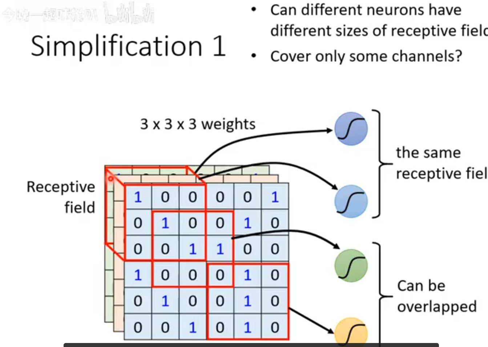

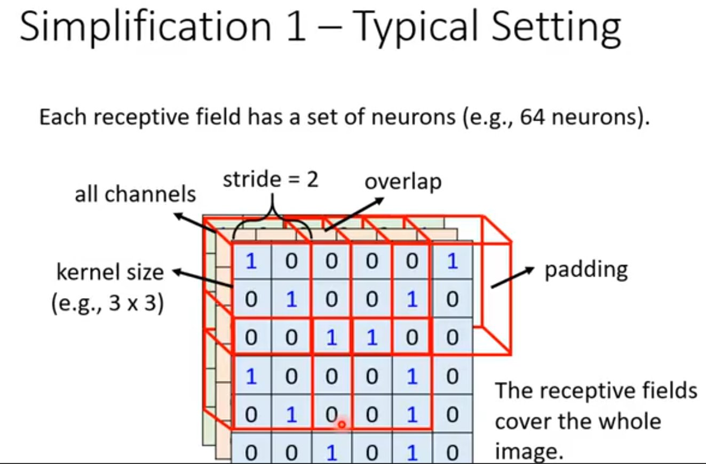

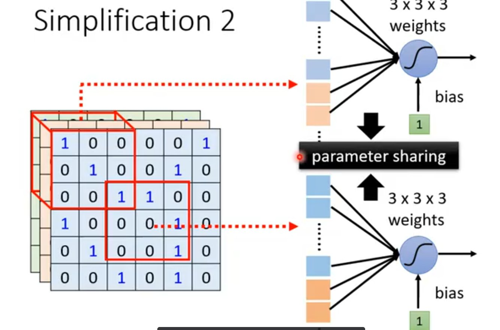

### 参数共享省了多少（实测）

输入 `3×32×32`，要得到 64 通道、`30×30` 的特征图：

| 做法 | 参数量 |
| --- | --- |
| 全连接 | **177,004,800** |
| 3×3 卷积 | **1,792** |

差 **98,775 倍**。这就是 CNN 能吃大图的真正原因 —— 不是它更聪明，
是我们先把「图里该有的规律」写进了结构。

## 2. 三个最容易混的点

### 2.1 重叠不是为了「防遗漏」

常见说法是「让卷积区域高度重合，避免漏掉特征」。**这个动机是错的。**

- `stride ≤ kernel` 时本来就不漏（`stride = kernel` 就是无缝切块）
- 只有 `stride > kernel` 才会出现空洞（真的漏）
- 重叠的真实收益：相邻输出共享像素 → 对小幅平移更鲁棒、边界过渡更平滑
- 代价：`stride = 1` 时每个像素被算 `k²` 次

`padding` 的真实作用也有两个：控制输出尺寸（same padding），以及让边缘像素被卷积的次数
和内部一致（否则角落只被卷 1 次、中心被卷 `k²` 次，边缘信息利用严重不足）。

### 2.2 通道数 ≠ 感受野（两根独立旋钮）

这是最容易缠在一起的一对概念：

| 旋钮 | 由什么决定 | 决定什么 |
| --- | --- | --- |
| 通道数 | 你设几个 filter | 看**多少种**特征 |
| 感受野 | kernel 大小 × stride 累积 | 看**多大**范围 |

实测：`1×1 conv` 和 `3×3 conv` 都能把 3 通道变成 16 通道（参数 64 vs 448），
但前者每个输出只看 1 个像素，后者看 3×3。

所以「层数变深 → 通道变多 → 看到的信息更多」这句话里混了两件事：
通道变多是 filter 变多，感受野变大是 kernel/stride 累积的结果，两者互不影响。

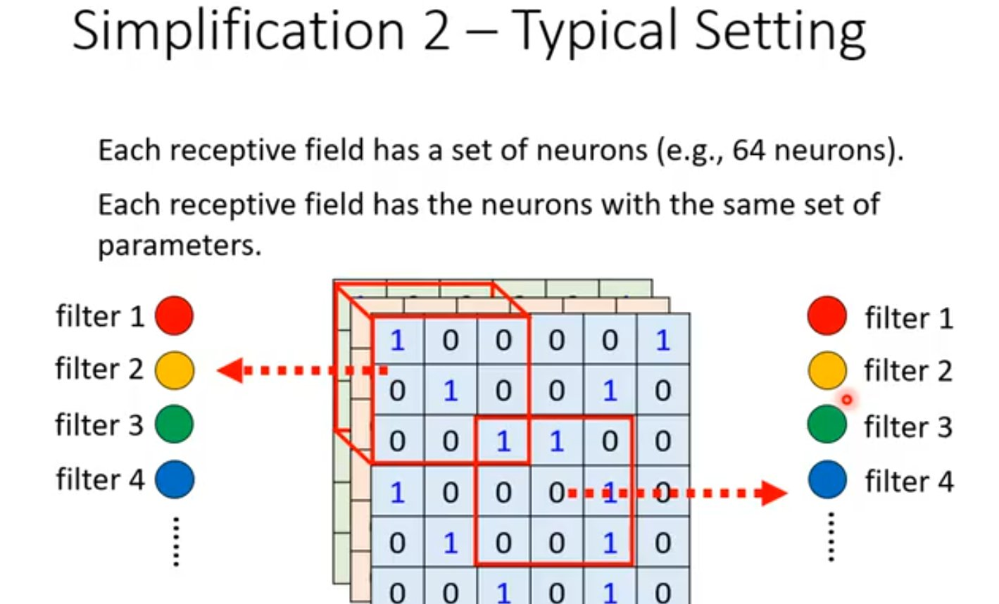

### 2.3 感受野到底怎么长

每层 3×3，只改 stride：

| layer | 1 | 2 | 3 | 4 | 5 | 6 |
| --- | --- | --- | --- | --- | --- | --- |
| s=1 | 3 | 5 | 7 | 9 | 11 | 13 |
| s=2 | 3 | 7 | 15 | 31 | 63 | 127 |

`stride=1` 时感受野是**线性**的（`RF = 2L + 1`），`stride=2` 才**指数**增长。
所以「想做深」和「想快速扩大视野」是两件事 —— 后者靠下采样。

反过来说，这张表也能当判据：目标在输入上是 40px 见方，感受野过了 40 就到顶了，
再堆层对「看见它」没有增益。

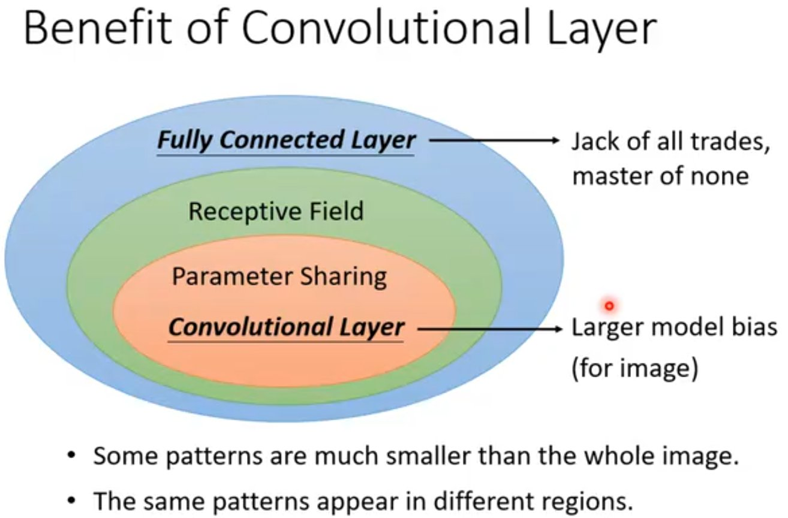

## 3. Pooling

池化层**没有参数**，行为完全由超参决定（kernel / stride / max 还是 avg），确实不用学。

但它给的不变性是**局部**的，实测：

| 做法 | 图像右移 1px 后的最大差异 |
| --- | --- |
| 2×2 maxpool | **1.0**（变了） |
| global max pool | **0.0**（真不变） |

2×2 maxpool 只是把「4 个格子之内的差别」压成「1 个格子的位移」，没有消除差别。
要真正平移不变，得把整张图压成一个数。

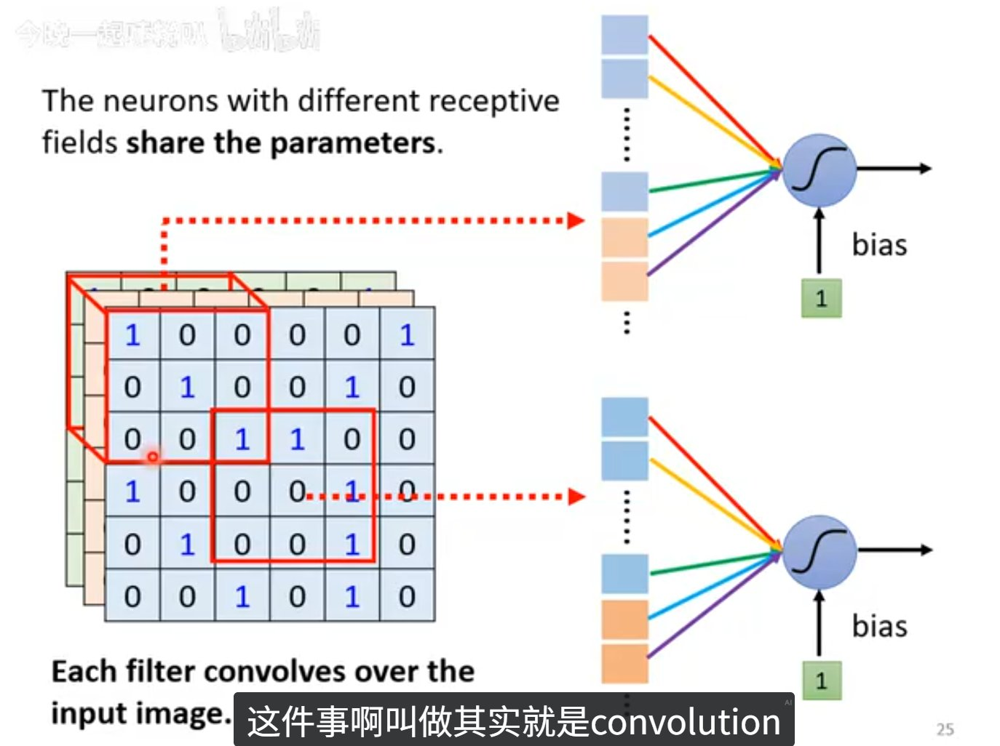

现代网络还常用 `stride=2` 的卷积代替池化 —— 因为那个下采样**可以学**。

## 4. 全连接层做什么

CNN 一路提特征，最后 flatten 成向量交给 FC：FC 的作用是**在特征向量上做线性组合 + 非线性，
把「空间特征」变成「类别打分」**。

两个要点：

- FC 丢掉了位置信息（flatten 之后空间结构被打散）。对分类是好事，对检测/分割是坏事。
- FC 参数量巨大、易过拟合，现代网络用 **GAP（全局平均池化）** 替掉大部分 FC，
  ResNet 只在最后一层留一个 FC。

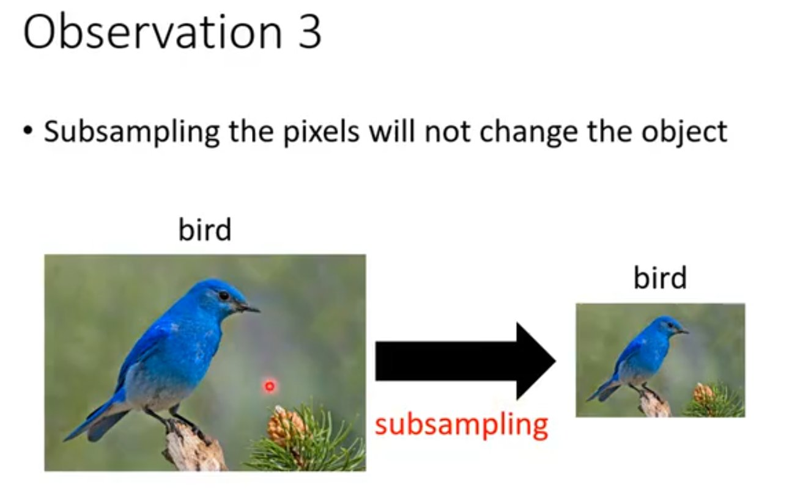

## 5. 深到什么程度算够

**没有理论标准**，但有四个能用的判据：

1. **验证集饱和** —— 加层后 val acc 不动（<0.5%）就停。最常用，本质仍是经验。
2. **感受野够不够** —— 这个能算，不用试（见 2.3 的表）。
3. **训练能不能推动** —— 太深会退化（56 层曾比 20 层更差），不是过拟合，是梯度传不下去；
   有残差/BN 才敢堆。
4. **预算** —— 参数 / FLOPs / 延迟。部署场景里这条往往是硬的。

经验事实：ImageNet 上 ResNet-50 → 101 → 152 是 1% 量级的递减收益，VGG19 之后基本没人比「更深」。
工业界不自己试深度，而是**选现成骨干**（ResNet18/34/50），精度不够先加数据、加分辨率。

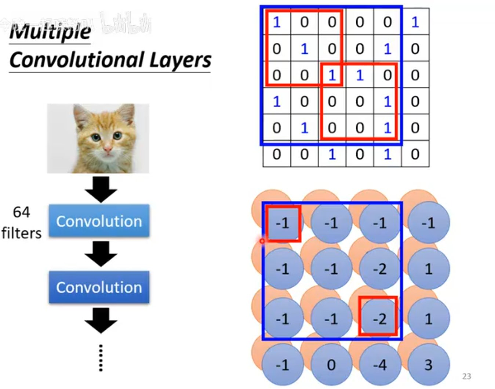

## 6. CNN 的不变性边界

| 变换 | CNN 有不变性吗 |
| --- | --- |
| 平移（小幅） | 有，靠 pooling，但只是局部容忍 |
| **缩放** | **没有** |
| **旋转** | **没有** |
| **翻转** | **没有** |

所以这三类只能靠 data augmentation 「教」进去。

但增强不能破坏标签语义 —— 比如洗涤标签分类里，文字方向是有意义的，
一旦 h-flip 或大角度旋转，「正面朝上」的语义就变了。这条边界比「多增强总没坏处」重要得多。

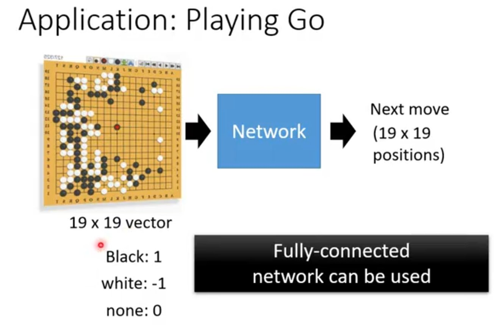

## 7. 术语对齐

| 说法 | 判断 | 精确表述 |
| --- | --- | --- |
| 学出来的是卷积核参数 | ✅ | 还有 bias；有 BN 时还有 γ/β |
| 卷积核 = 神经元 | ⚠️ | 一个 filter 对应**一张特征图**；图上**每个位置**才是一个神经元，它们共享这一个 filter |
| 卷积核 = 权重 | ✅ | `k×k×C_in` 个权重 + 1 个 bias |
| 卷积核 = filter | ✅ | 同义词，一个 filter 出一个 channel |
| 有 bias | ✅ | `Conv2d` 默认有；但**接 BN 时要 `bias=False`** —— bias 会被 BN 的均值减掉，纯浪费参数 |

另外：深度学习里的 "convolution" 严格说是 **cross-correlation**（不翻转 kernel）。
数学上的卷积要先把核翻转 180°，框架里省掉了，因为反正权重是学出来的。

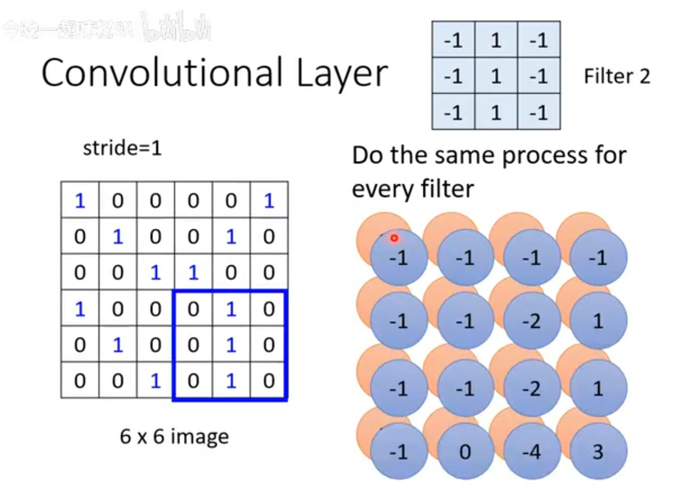

## 8. 两个延伸

**CNN 不只是看图。** 围棋（19×19 = 361 个交叉点）可以当成一张 19×19 的单通道图，
输出 361 分类。局部棋形在棋盘各处重复出现 → 参数共享正好契合，所以 CNN 比 FC 好用。
AlphaGo 的 policy/value network 就是 CNN。

> 注意是**围棋**不是象棋 —— 象棋是 9×10 的棋盘，语义和规模都不同。

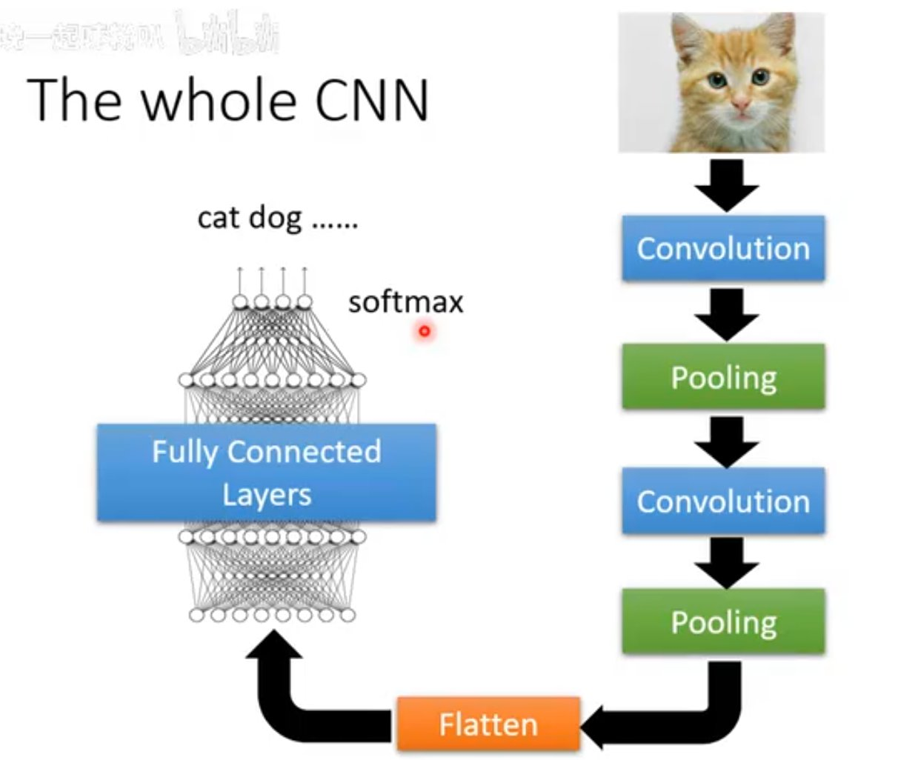

**CNN 和 self-attention 的关系**：CNN = 只能在感受野内 attend 的 attention；
attention = 感受野可学习的 CNN。数据少时 CNN 更优，数据多时 attention 反超（ViT 论文）。

## 9. 对应代码

```bash
python main.py cnn
```

`cnn/demo.py` 四节：感受野表 / 参数量对比 / 1×1 vs 3×3 / pooling 不变性。
