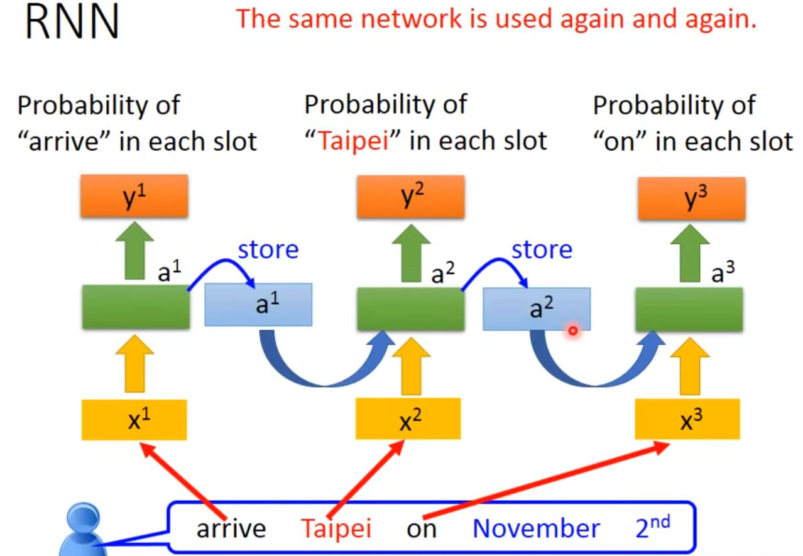
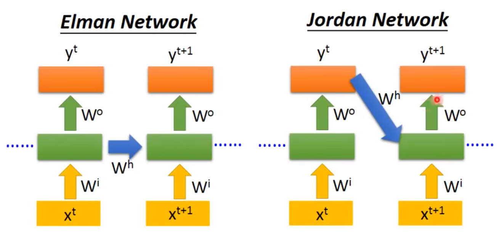
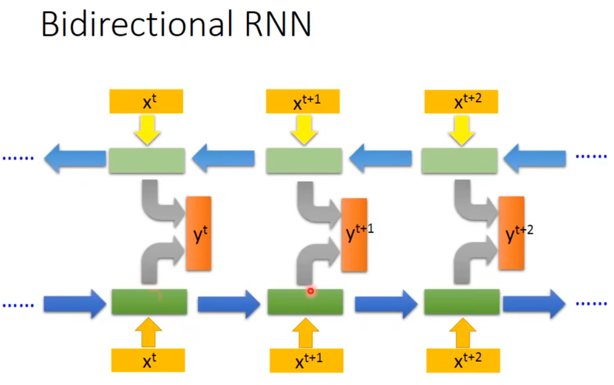

# 02 · RNN

> 一句话：**循环 = 同一组权重沿时间反复使用**。不是数据绕回去了，是同一个函数被调用 T 次。

## 1. 先把三根轴拆开

初学者 90% 的困惑来自把三根互相垂直的轴混成一根：

| 轴 | 是什么 | 由谁决定 | 并行吗 |
| --- | --- | --- | --- |
| 水平 | 时间步 `t` | 序列长度（几个词） | **串行** |
| 框内竖排 | `hidden_dim` | 你设的超参 32/64/128 | 并行 |
| 垂直 | 层 `num_layers` | 你设的超参 | 层间串行 |

课件里水平方向画的那一串框，是**同一个 cell 被调用了 T 次**，不是 T 个不同的 cell。
所以「水平方向连不连接」这个问题本身要改一下：水平方向的箭头不是两个单元之间的连线，
是**同一个单元的时间状态传递**。

推论：一个 LSTM 层里参数只有一份，和序列长度无关。

## 2. 单向 RNN

同一个 cell 反复调用，`a^t` 只看得见 `x^1..x^t`。每一步的 `a^t` 都存下来，
既是下一步的输入，也是这一步输出的唯一来源 —— 课件里 "store" 那条蓝箭头。

```
a^t = tanh(W_i · x^t + W_h · a^{t-1} + b)
```

- `W_i`：输入 → 隐层
- `W_h`：隐层 → 隐层（recurrent，同一个矩阵反复用）
- `W_o`：隐层 → 输出



> Jordan Network 只差一处：recurrent 的来源从 `a^{t-1}` 换成上一步的输出 `y^{t-1}`。



## 3. 双向 RNN

正向通道 `x^1 → x^T`，反向通道 `x^T → x^1`，两套**独立参数**，各自攒一串中间结果。
位置 `t` 的输出同时读两个方向：

```
y^t = W_o([ a_fwd^t ; a_bwd^t ])
```



### 实测：反向通道的差异只出现在第 1 步

输入 `arrive taipei on November 2nd` vs `leave taipei on November 2nd`（只差第一个词）：

| t | token | 单向 d(a) | 双向 d(a_fwd) | 双向 d(a_bwd) |
| --- | --- | --- | --- | --- |
| 1 | arrive/leave | 2.96151 | 1.06307 | 2.08907 |
| 2 | taipei | 0.94493 | 0.27185 | **0.00000** |
| 3 | on | 0.55043 | 0.17778 | **0.00000** |
| 4 | november | 0.24388 | 0.11126 | **0.00000** |
| 5 | 2nd | 0.11248 | 0.05528 | **0.00000** |

反向通道从句子末尾开始读，走到 t=2~5 时它还没碰到第一个词，两句对它来说一模一样 ——
所以差值**精确等于 0**。这不是 bug，是 RNN 方向性本身。

## 4. 信息会衰减

单向那一列从 2.96 一路缩到 0.11（cos 0.9955），第一个词的信息每过一步被 tanh 压一次。
5 步就衰减成这样，句子一长更明显 —— 这就是 RNN 的**远距离信息衰减**，LSTM/GRU 要解决的核心问题。

整句表示差距：

| 模型 | d | cos |
| --- | --- | --- |
| 单向（最后一步） | 0.11248 | 0.9955 |
| 双向（两通道 mean-pool 拼接） | 0.48344 | 0.7752 |

真去做 arrive / leave 的分类，双向这个表示明显更好用。

## 5. 能并发吗

| 方向 | 能否并行 | 原因 |
| --- | --- | --- |
| 时间维 | ❌ | `h^t` 必须等 `h^{t-1}` |
| batch 维 | ✅ | 不同句子互不影响 |
| hidden_dim | ✅ | 同一时刻的矩阵乘 |

实测因果性（改最后一个 token，看前面的输出变不变）：

| t | 输入 | max\|Δh^t\| |
| --- | --- | --- |
| 1 | 3.0 | 0.00000000 |
| 2 | 1.0 | 0.00000000 |
| 3 | 0.0（改成 9） | 0.33098918 |

前两步精确为 0 —— 后面还没发生的事影响不到它。这就是「时间维必须串行」的硬证据。

## 6. Q&A

**Q：循环神经网络，「循环」到底指什么？**
A：指**权重共享**：同一个函数被反复调用，并把上一次的输出作为这一次的额外输入。
物理上没有任何回路，内存里就是一个 `for t in range(T)`。

**Q：水平上看起来有多个 cell，实际只有一个？**
A：对。展开图（unrolled diagram）只是为了画得下，参数只有一份。

**Q：每层 3 个单元，输入分别是 3 个词？**
A：这里混了两根轴。**3 个词 = T=3（水平方向）**；`hidden_dim=3` 是每个位置那个向量的**宽度**（竖排）。
两者无关：100 个词的句子，`hidden_dim` 还是 3。

**Q：dimension 32/64/128 是「隐藏层数量」吗？**
A：是隐藏层**宽度**（`hidden_size`）。层数叫 `num_layers`，是另一个超参。

**Q：单个 cell 的输入是 scalar 吗？**
A：看你的输入是什么。标量时间序列（3, 1, 0 这种）时是 scalar；NLP 里 `x^t` 是词向量。
`hidden_dim` 个隐藏单元的值才是「一个 scalar」。

## 7. 对应代码

```bash
python main.py rnn
```

`rnn/demo.py`：单向 → 双向 → 两句话差距 → 汇总。`rnn/cell.py` 是 ElmanCell，
`rnn/models.py` 是 UniRNN / BiRNN（手写时间步循环，因为要保留每步的 `a^t`）。
