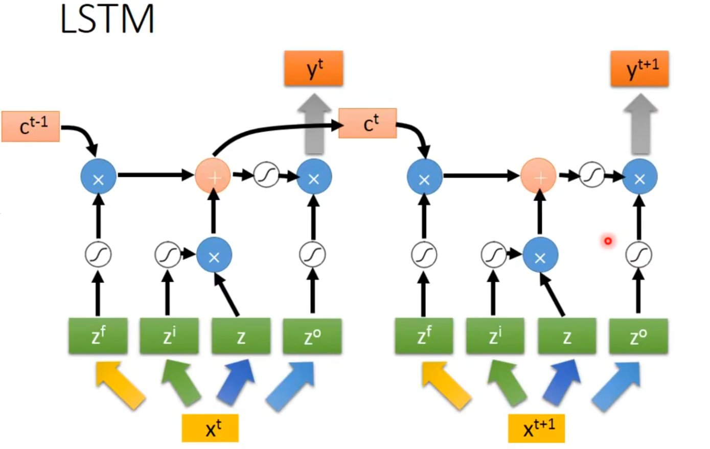
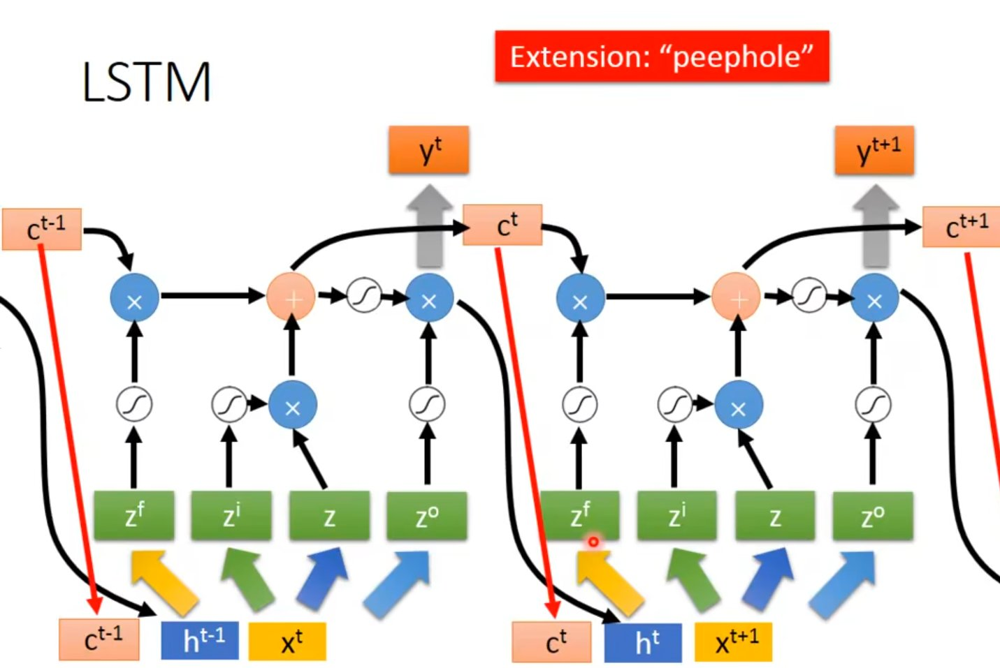
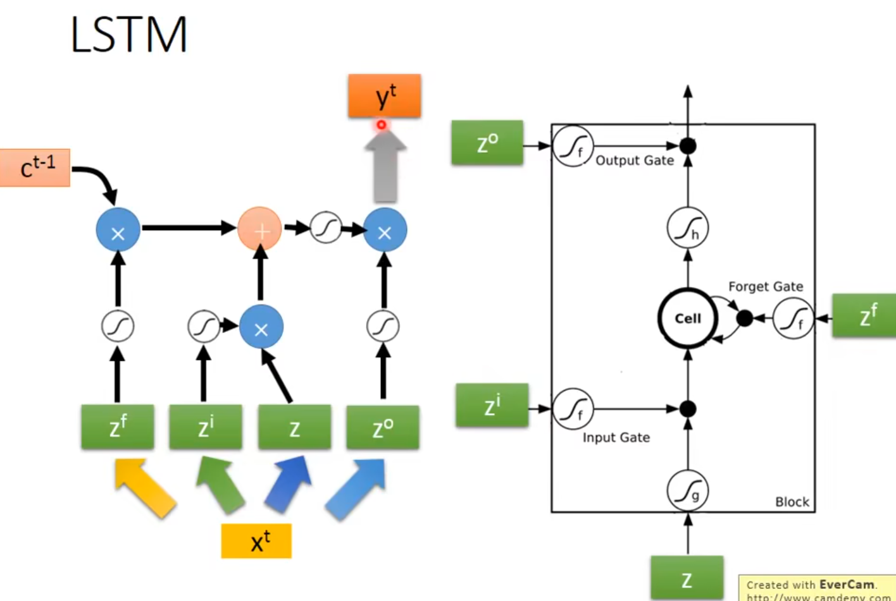

# 03 · LSTM

> 一句话：RNN 加一条 `c` 通道和三个门。`c` 走**加法**，所以梯度不用穿过一串 tanh 的导数连乘。

## 1. 四个门 + 一条通道

```
z^f = σ(W_f [x^t ; h^{t-1}] + b_f)      忘记门：c^{t-1} 留多少
z^i = σ(W_i [x^t ; h^{t-1}] + b_i)      输入门：这次写多少
z   = tanh(W_z [x^t ; h^{t-1}] + b_z)   候选：写什么
z^o = σ(W_o [x^t ; h^{t-1}] + b_o)      输出门：露多少

c^t = z^f ⊙ c^{t-1} + z^i ⊙ z           ← 加法通道，记忆本体
h^t = z^o ⊙ tanh(c^t)                  ← 下一步的输入 + 这一步的输出
```

注意 `c` 那一行是**加法**不是乘法 —— 这是 LSTM 相对朴素 RNN 的结构性优势，后面第 5 节细说。



## 2. 三套记法对照

同一份东西有三种画法，对不上就会看不懂：

| Block 图 | 链图 | 代码 | 含义 |
| --- | --- | --- | --- |
| `z` → `f(z_f)` | `z^f` → σ | `W_f` → sigmoid | 忘记门，留多少 c |
| `z_i` → `f(z_i)` | `z^i` → σ | `W_i` → sigmoid | 输入门，写多少 |
| `z` → `g(z)` | `z` → tanh | `W_z` → tanh | 候选内容 |
| `z_o` → `f(z_o)` | `z^o` → σ | `W_o` → sigmoid | 输出门，露多少 |
| `c`, `c'` | `c^{t-1}`, `c^t` | `c` | 记忆，走加法 |
| `a` | `h^t` | `h_t` | 输出，也是下一步输入 |

**Block 图（单步）就是链图里的一个框。** 链图只是把同一个 Block 沿时间贴了 T 份 ——
这正好印证了「水平方向只有一个 cell」这件事。





> **一处课件不一致**：链图里 `z` 那条线直接进了乘法，没画 tanh；Block 图里明确有 `g`。
> 标准写法是 `g = tanh`，代码按标准写。

## 3. 因果性：h^t 只看得到 x^1..x^t

改最后一个时间步（0 → 9），看每步的 `h^t` 变化：

| t | 输入 | max\|Δh^t\| |
| --- | --- | --- |
| 1 | 3.0 | 0.00000000 |
| 2 | 1.0 | 0.00000000 |
| 3 | 0.0 | 0.33098918 |

前两步精确为 0 —— 和 RNN 一样，时间维必须串行。这也说明**输入维、隐藏维可以并行，
只有时间维不行**。

## 4. 忘记门：c 到底能记多久

序列 8 步，看第 1 步写进 `c` 的那部分还剩百分之多少：

| | 2 | 3 | 4 | 5 | 6 | 7 | 8 |
| --- | --- | --- | --- | --- | --- | --- | --- |
| 正常 f（≈0.5） | 41% | 18% | 8% | 4% | 2% | 1% | 0% |
| f 钉死 1.0 | 100% | 100% | 100% | 100% | 100% | 100% | 100% |

`c^t = z^f ⊙ c^{t-1} + ...`，每一步都乘一次 `z^f`。随机初始化下 `f ≈ 0.5`，一步砍半，
8 步基本归零。钉死 1.0 就一点不丢。

**两个提醒**：

- 真实训练时 `f` 是**学出来的**。LSTM 不是天生能记长程，是训练让它学会「该留就留」。
- 所以「LSTM 解决了长程依赖」这句话不准确 —— 它提供的是**能学会**保留的机制，不是保证。

## 5. 为什么能缓解梯度消失

这是最容易被讲成「因为门多」的地方，其实不是。

- 朴素 RNN：`h^t = tanh(W h^{t-1} + ...)`，梯度回传要连乘一串 `W · tanh'`，
  每乘一次就被压缩一次，L 步后接近 0。
- LSTM：`c^t = z^f ⊙ c^{t-1} + ...`，`∂c^t / ∂c^{t-1} = z^f`。
  只要 `z^f ≈ 1`，梯度就能**原样**传回去，不用穿 tanh。

换句话说，`c` 是一条**加法高速通道**，门只是控制这条通道的开合。
这也是后来 ResNet 的残差连接、以及「gradient highway」这类说法的同一个直觉。

## 6. Peephole（课件第二页那个红圈）

让三个门直接偷看 `c^{t-1}`：

```
z^f = σ(W_f [x^t ; h^{t-1}] + W_cf ⊙ c^{t-1} + b_f)
```

标准 LSTM **没有**这条线，代码里也没实现。要加就是三个 `(H, H)` 的矩阵，
属于可选项 —— 理解主干的 `c` 通道之后，这条线只是锦上添花。

## 7. 常见误解

| 说法 | 判断 |
| --- | --- |
| 「LSTM 水平方向有多个 cell 相连」 | ❌ 是同一个 cell 沿时间复用 T 次 |
| 「hidden_dim=3 就是 3 个 cell，分别吃 3 个词」 | ❌ 词数是时间步 T；hidden_dim 是向量宽度 |
| 「LSTM 天生能记长程」 | ❌ 是训练学出来的；随机初始化下 `f≈0.5`，一步砍半 |
| 「LSTM 因为门多所以梯度不消失」 | ❌ 是 `c` 的加法通道，不是门的数量 |

## 8. 对应代码

```bash
python main.py lstm
```

`lstm/cell.py` 是 `LSTMCell` / `LSTMLayer`（含 `forced_forget` 开关，只用于演示），
`lstm/demo.py` 五节：记法对照 / 参数量 / 门值 / 因果性 / 忘记门 / peephole。
