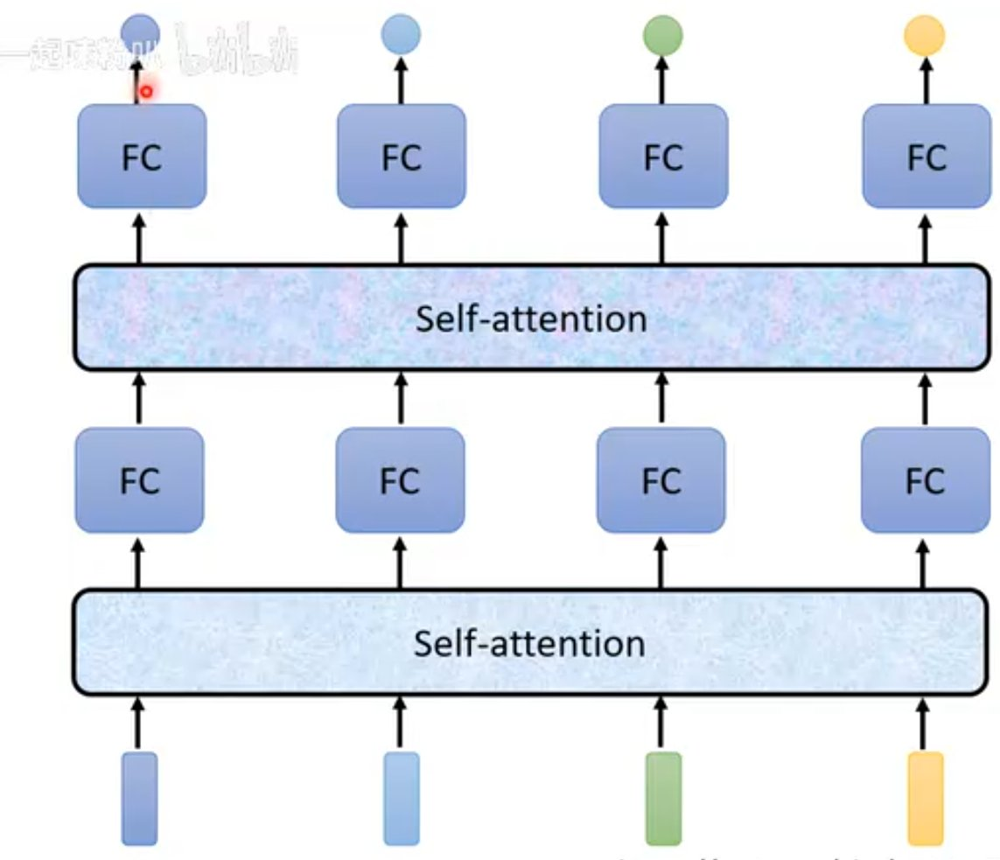
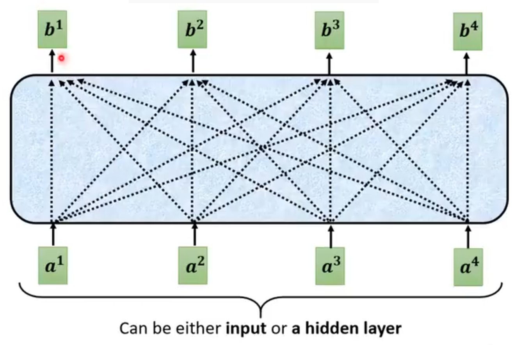
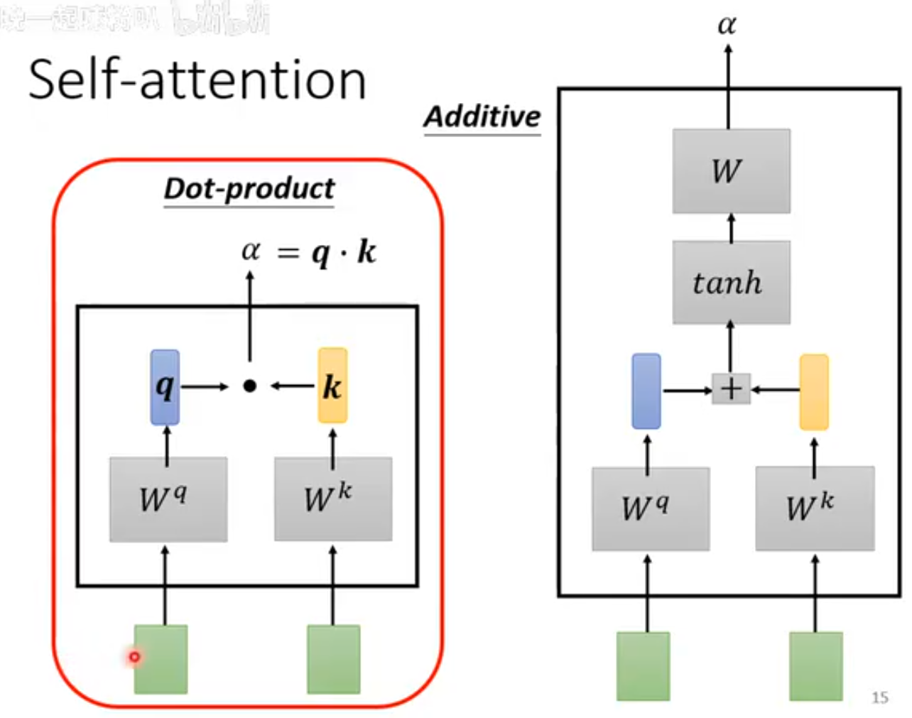
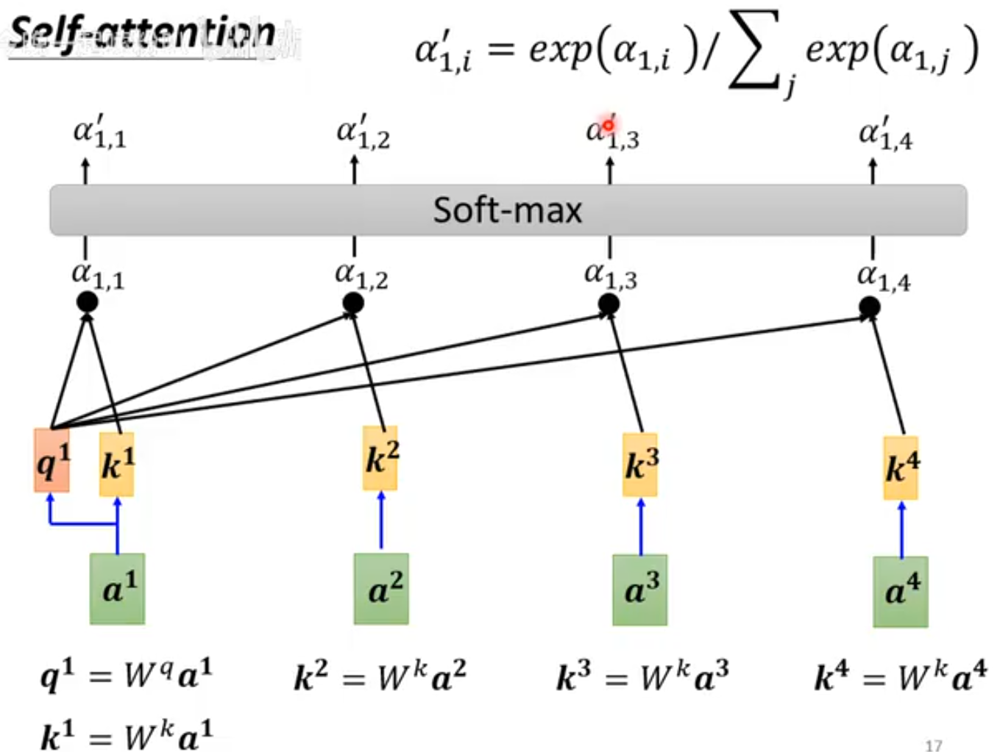
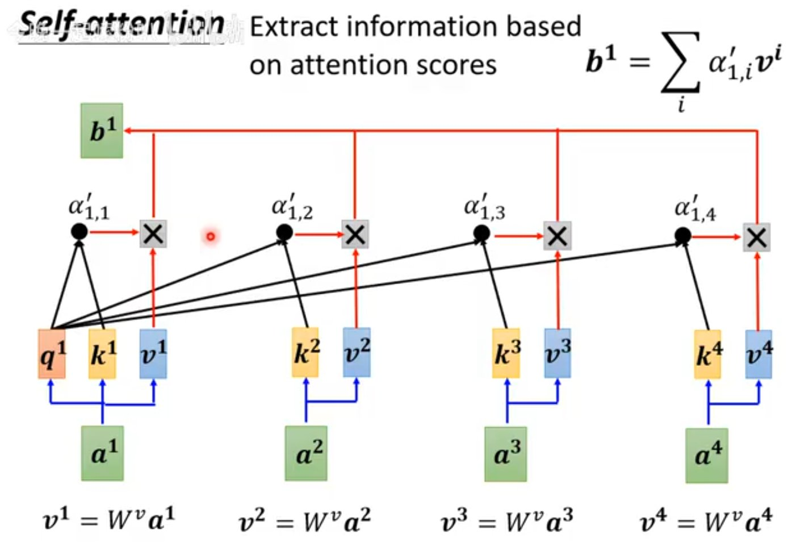
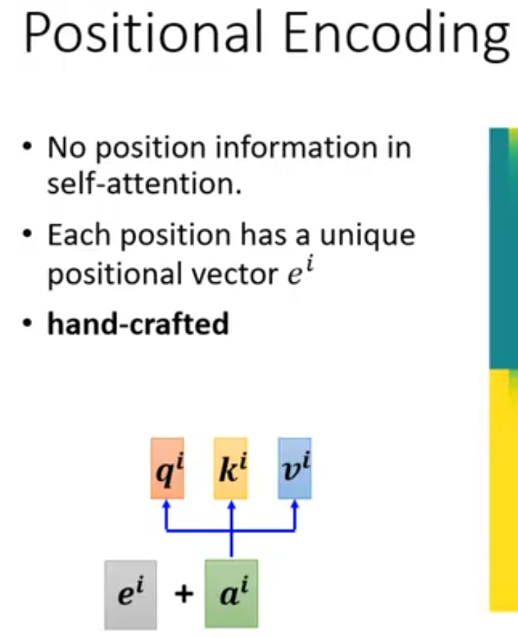
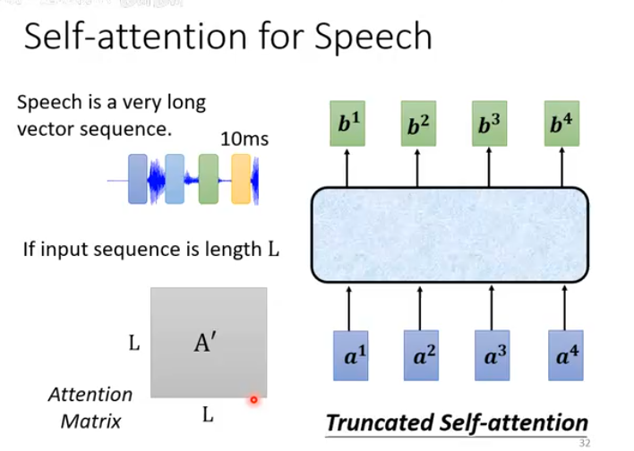
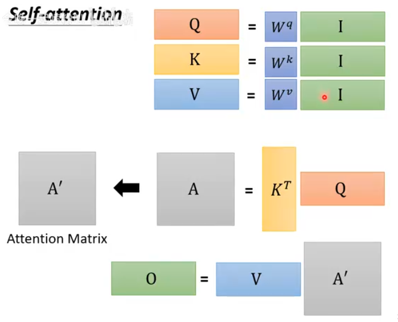
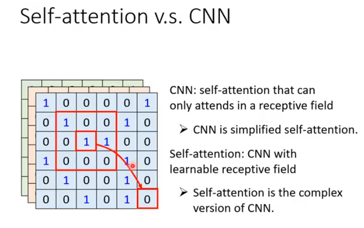
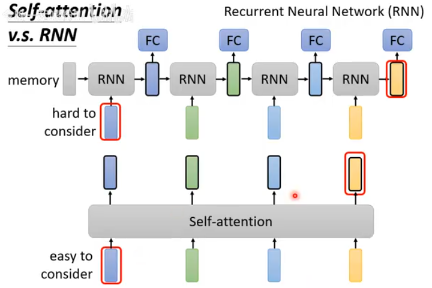

# 04 · Self-Attention

> 一句话：每个位置用**自己的 Q** 去和所有位置的 K 算相似度，再把所有位置的 V 按权重加权求和。

## 1. 机制：五步

严格按照课件的矩阵形状（**一个 token 一列**）：

```
I  : d_model × N          一个 token 一列
Q  = W^q I,  K = W^k I,  V = W^v I        d_k × N
A  : A[j][i] = k^j · q^i                  N × N，行是 key、列是 query
A' = softmax(A)：每一列（同一个 query 对所有 key）归一化
O  = V A'                                 d_v × N
```

| 步骤 | 做什么 | 形状 |
| --- | --- | --- |
| 1 | 三个线性变换得到 Q/K/V（**这就是全部可学参数**） | `d_k × N` |
| 2 | `Q` 和每个 `K` 点积 → 关联性 | `N × N` |
| 3 | softmax 归一化 → 权重和为 1 | `N × N` |
| 4 | 用权重对所有 `V` 加权求和 | `d_v × N` |
| 5 | （多头时）拼接再乘 `W^O` | `d_model × N` |

实测校验：`A'` 每一列加起来精确等于 `(1.0, 1.0, 1.0, 1.0)`；
手算 `q¹·k³ = 1.0`，正好等于 `A` 的第 3 行第 1 列 —— 对应课件里 `α_{1,3} = k³·q¹`。

**课件组图 A｜self-attention 的计算流程**











## 2. 两句话讲清 Q/K/V 的分工

- **Q（query）= 我要找什么**
- **K（key）= 我是什么（供别人匹配）**
- **V（value）= 我实际携带的内容**

注意一个常见误解：「用 Q 找到相关的 K，再带上自己的 V」这句话要补两点：

1. `A` 必须过 **softmax** 才是权重（否则是未归一化的分数）；
2. 输出是**所有位置的 V 的加权和**，不只是「自己那个 V」。自己那一份只是其中一项。

## 3. 没有位置信息（这一条最要命）

对 self-attention 来说，`(a¹,a²,a³)` 和 `(a³,a¹,a²)` 是**同一个集合** ——
它压根不知道谁在前。这不是口头结论，可以严格测：

| 实验 | 结果 |
| --- | --- |
| 打乱 token 顺序（无 PE） | 输出只是跟着重排，`max\|Δ\| = 0.00e+00` |
| 加正弦位置编码后打乱 | `max\|Δ\| = 0.89` |

也就是说：**没有 PE 时，模型看到的是一个「词袋」**。所以 PE 不是可选项，是必需品。



## 4. 位置编码：两种做法

| 做法 | 形式 | 参数量 | 谁在用 |
| --- | --- | --- | --- |
| hand-crafted | `PE[pos, 2i] = sin(pos/10000^{2i/d})`，`PE[pos, 2i+1] = cos(...)` | 0 | 原论文 Transformer |
| learned | 一张 `N × d` 的表，和词向量一样靠梯度学 | `N×d` | BERT |

关键细节：PE 是**加**到输入上的（`x + PE`），不是拼接到后面。
所以两种做法可以随便换 —— 只要形状对得上。



## 5. 多头

不是「把同一个 attention 算几遍」，是**几套独立的 W^q/W^k/W^v 在不同子空间里找不同类型的关联**，
最后 concat 再乘 `W^O`。

实测：两个 head 的注意力矩阵相关系数 `-0.118`，确实不同。但随机权重下只是「碰巧不同」，
真实训练才会分化成语法 / 指代 / 相邻位置这些角色。



## 6. 和 RNN 比快

| L | self-attention | 逐时间步（类 RNN） | 倍数 |
| --- | --- | --- | --- |
| 64 | 0.04 ms | 0.79 ms | 20.8x |
| 256 | 0.14 ms | 3.32 ms | **23.1x** |
| 1024 | 2.11 ms | 14.24 ms | 6.8x |
| 2048 | 11.08 ms | 27.88 ms | 2.5x |

**倍数不是一路涨的**：256 处见顶，之后回落。因为 attention 是 `O(L²)` ——
L=2048 时注意力矩阵就有 400 万个元素。

所以「self-attention 比 RNN 快」这句话要加条件：

- ✅ 中等长度、能并行时更快
- ❌ 短序列（几十个 token）未必更快
- ❌ 超长序列会被 `O(L²)` 拖死 → 所以才要 Truncated Self-attention

两点 caveat：上面的 RNN 是 Python 循环，cuDNN 融合实现会快很多；但「串行 L 步」这个结构限制改不掉。



## 7. 和 CNN 的关系

- **CNN** = 只能在感受野内 attend 的 self-attention
- **self-attention** = 感受野**可学习**的 CNN

实践含义（ViT 论文那张图）：**数据少时 CNN 更优，数据多时 self-attention 反超**。
小数据集上直接上 Transformer 往往打不过 ResNet。



## 8. Q&A

**Q：注意力会不会「漏」信息？**
A：不会漏，但会**稀释**。softmax 有权重和为 1 的约束，位置一多，每个位置分到的权重就小，
输出趋向平均。这就是多头和大 `d_k` 存在的意义之一 —— 给模型更多「分开看」的空间。

**Q：为什么 PE 用加法而不是拼接？**
A：拼接会改变维度（`d → d+d`），后续所有矩阵都要跟着改；加法保持维度不变，
而且在高维空间里「加一个固定向量」已经足够让每个位置可分。

**Q：self-attention 的计算量主要花在哪？**
A：`N×N` 的注意力矩阵。`QK^T` 是 `N²d`，再乘 `V` 又是 `N²d` —— 所以是 `O(N²d)`，
对长序列是主要瓶颈。

**Q：多头是不是越多越好？**
A：不是。头数 × 每头维度 = `d_model` 固定时，头太多会让每个头太窄（`d_k` 太小），
表达力反而下降。常见是 8/12/16 头，`d_model` 512/768。

## 9. 对应代码

```bash
python main.py attention
```

`attention/model.py` 是 `SelfAttention` + `sinusoidal_pe`，
`attention/demo.py` 五节：全流程 / 无位置信息 / 位置编码 / 多头 / 速度对比。
