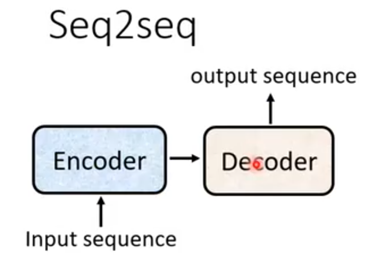
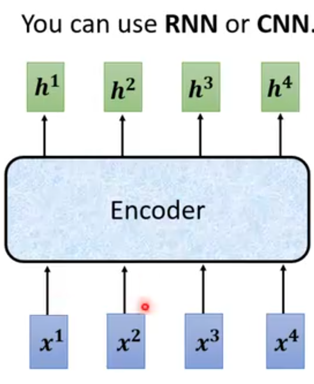
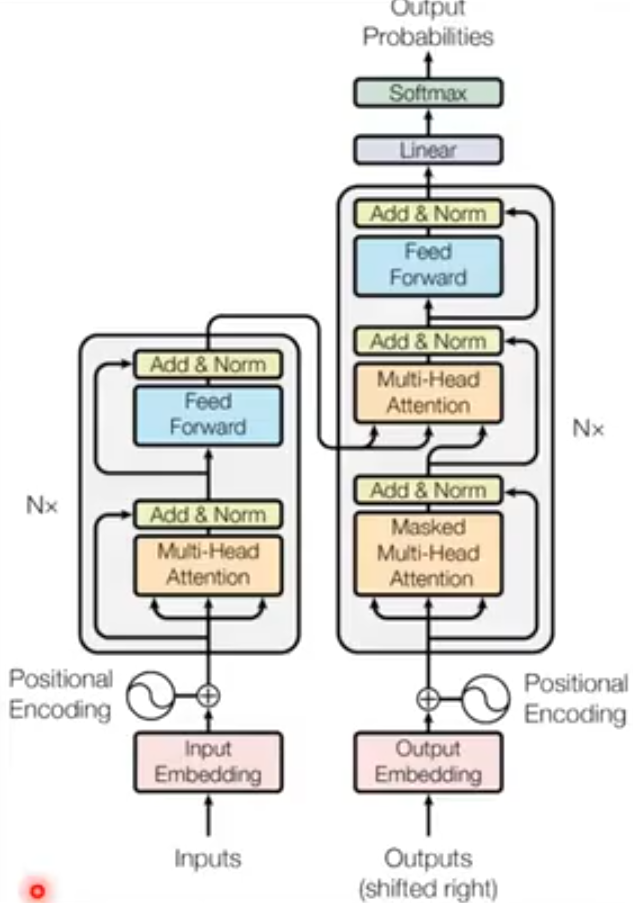
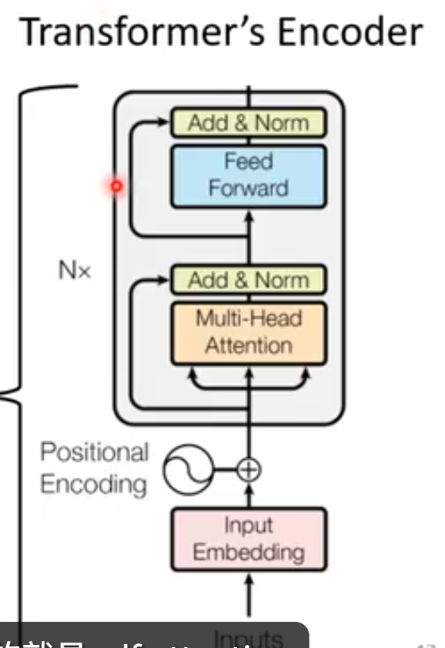
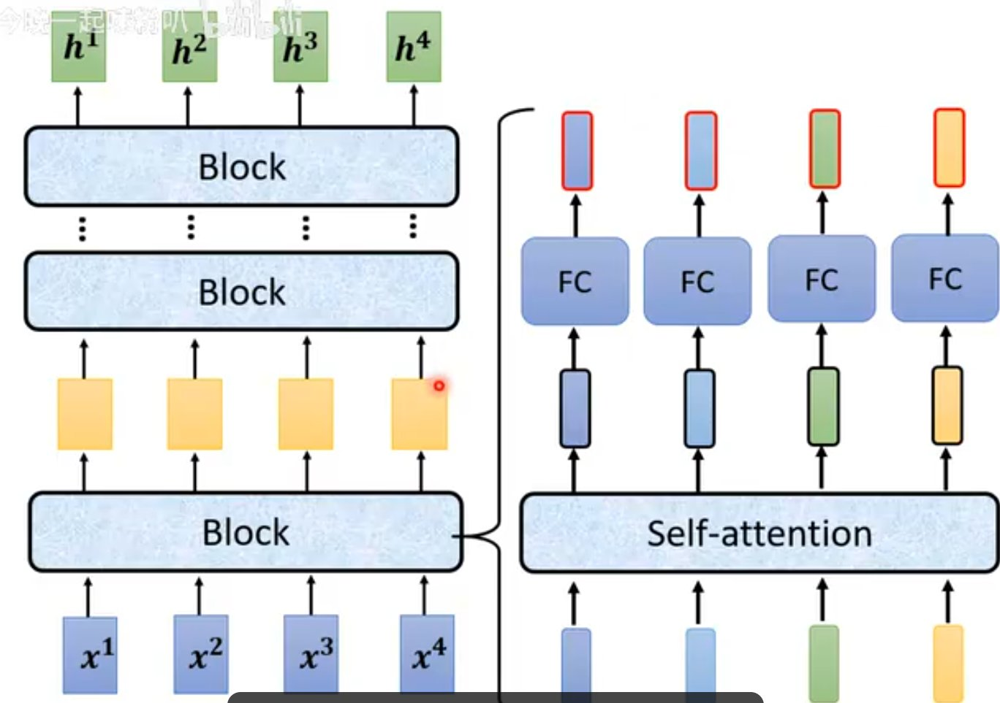
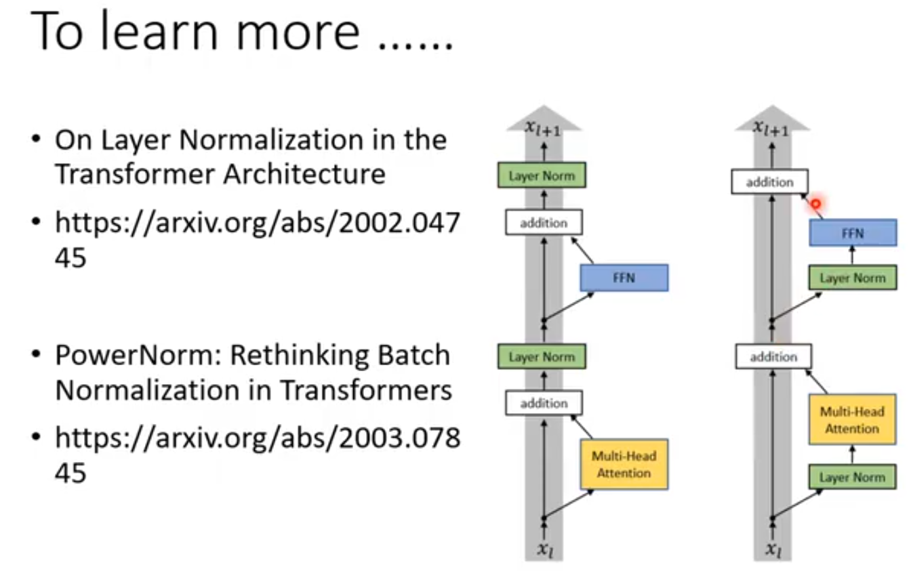

# 05 · Transformer

> 一句话：一个 block = attention（跨位置通信）+ FFN（位内计算），外面套残差和 LayerNorm。

## 1. 一个 block 里有什么

```
x ──► [ multi-head self-attention ] ──► +x ──► LN ──┐
                                                     │
     ┌───────────────────────────────────────────────┘
     └──► [ FFN: Linear → ReLU → Linear ] ──► +x ──► LN ──► 下一层
```

只有两个子层。encoder 就这两个，decoder 在前面多一个 cross-attention。





## 2. FFN 是什么，干什么

形状：`d_model → 4·d_model → d_model`，中间夹一个 ReLU。

`d=512, d_ff=2048` 时：

| 子层 | 参数量 | 占比 |
| --- | --- | --- |
| attention（4 个 `d×d`） | 1,050,624 | 33% |
| **FFN** | **2,099,712** | **67%** |

**一个 block 里 2/3 的参数在 FFN 上，不在 attention 上。** 这点很容易搞反。

### 它到底干什么：改一个 token，看谁跟着变

| 位置 | 过 FFN 的变化 | 过 attention 的变化 |
| --- | --- | --- |
| 1 | 0.0000 | 1.2178 |
| 2 | **2.0127** | 0.8166 |
| 3 | 0.0000 | 1.9430 |
| 4 | 0.0000 | 1.3292 |

改动第 2 个 token：

- FFN 只有第 2 位变了，其余**精确为 0** → 对它来说位置之间**完全不通信**
- attention 四个位置全变 → 大家都得 attend 第 2 个 token

所以分工是：

| | 作用 | 类比 |
| --- | --- | --- |
| attention | 跨位置**收集**信息 | 通信 |
| FFN | 在每个位置内部**加工** | 计算 |

为什么必须有 FFN？attention 的输出是 V 的**加权平均**（权重非负、和为 1），
本质上只能「混合已有的东西」，造不出新特征。要造新特征，只能靠 FFN 这个逐位置的非线性映射。



## 3. BatchNorm vs LayerNorm

这两个不是「差不多的两种写法」，是**统计量取自哪些元素**的根本区别：

```
x: (B, L, d)   B = batch，L = 序列长度，d = d_model

LayerNorm  在最后一维 d 上算 mean/std   → 一个 token 自己归一化，跟别人无关
BatchNorm  在 (B, L) 上算                → 同一个维度跨所有样本、所有位置归一化
```

### 实测：BN 的两个致命问题

| 实验 | LayerNorm | BatchNorm |
| --- | --- | --- |
| ① padding 参与统计造成的偏差 | 0.00e+00 | **0.7843** |
| ② 同一句单独跑 vs 拼 batch 跑 | 0.00e+00 | **1.8479** |

- ① 序列长度不齐要 padding，padding 的 0 会污染 BN 的 mean/std —— 样本本身全是真 token，
  输出却被别人拉偏。
- ② **一个样本的表示会依赖同 batch 的其他人**。训练时 batch 组成一变统计就变；
  推理时（尤其自回归生成、batch=1）根本对不上训练时的分布。

LN 两条都不受影响：每个 token 自己算，训练和推理完全一致。





### 但别说成「BN 本质更差」

arXiv 2003.07845 (PowerNorm) 就在讲这件事：**把 masking 修对之后，BN 在 Transformer 里也能打**。
准确的说法是「BN 的前提在变长序列里不成立」，不是 BN 本身没用。

## 4. post-norm vs pre-norm

只差 norm 放在哪：

```
post-norm（原论文）  x = LN(x + Sublayer(x))
pre-norm（后来的主流）x = x + Sublayer(LN(x))
```

12 层 encoder block，同一份初始化：

| 层 | ‖x‖ post | ‖x‖ pre |
| --- | --- | --- |
| 1 | 8.00 | 8.21 |
| 3 | 8.00 | 8.68 |
| 6 | 8.00 | 9.56 |
| 9 | 8.00 | 10.54 |
| 12 | 8.00 | 11.15 |

post 被每层的 LN 反复拉回同一尺度，残差流上攒不住东西；pre 的残差流一路累加。

> **一个必须说清的 caveat**：我一开始想写「pre-norm 梯度更稳」，但实测两者都是 `2~3e3`，
> **单次反传看不出 post-norm 的劣势**。pre-norm 的好处是**训练动态**上的（早期更稳、
> 可省 learning-rate warmup），必须真训练才复现得了。
> 单次 backward 的统计代替不了训练实验 —— 这条比结论本身更值得记住。

arXiv 2002.04745 做的就是真实训练对比。所以「原始架构不是最优」这句成立，
但改的只是 norm 的位置，self-attention 和 FFN 本身没动。



## 5. Encoder 和 Decoder 的层怎么连

**先回答那个问题**：decoder 每一层的输入都是 encoder 最后一层的输出吗？

> **标准 Transformer：是。** 所有 decoder 层的 cross-attention 都读**同一个** memory
> （encoder 最后一层的输出）。层数不对等也没关系，8 层 encoder + 6 层 decoder 照样能跑。

你截的那几张（Conventional / Granularity Consistent / Granularity Parallel / Fine-Grained /
Full Matching / Adaptive Matching）正是在改这件事 —— 把不同层的 encoder 输出接到不同层的 decoder，
或者做一个可学习的「层间匹配」。这些都是论文级的改进，不是标准做法。

| 方案 | 怎么连 |
| --- | --- |
| Conventional | 全部 decoder 层 ← encoder **最后一层** |
| Granularity Consistent | 第 k 层 decoder ← 第 k 层 encoder（一一对应） |
| Granularity Parallel | 各层并行连，不走 cross-attention 的堆叠依赖 |
| Fine-Grained | encoder 前几层也能直连 decoder 浅层 |
| Full Matching | 全连接式的层间匹配（代价高） |
| Adaptive Matching | 用一个模块学「哪层接哪层」 |

标准结构记住一条就够：**memory 只有一份，是 encoder 最后一层的输出。**

## 6. 一句话总结

- attention 是**通信**，FFN 是**计算**，残差是**保底**，norm 是**稳定**
- 一个 block 的参数大头在 FFN（2/3）
- Transformer 用 LN 不用 BN，是因为序列长度不齐 + batch 依赖
- pre-norm 不是「更强」，是「更好训」

## 7. 对应代码

```bash
python main.py transformer
```

`transformer/norm.py`（LayerNorm / BatchNormSeq）、`transformer/block.py`
（FFN / MultiHeadAttention / EncoderBlock / DecoderBlock）、`transformer/demo.py` 四节。
