# 07 · 高效 Self-Attention

> 一句话：注意力矩阵是 N×N，所以贵。五条路都在放宽「每个 query 都要看每个 key」这个假设。

## 0. 先把问题量化

| N | 注意力矩阵 | 元素个数 | FLOPs (d=d'=64) |
| --- | --- | --- | --- |
| 256 | 256×256 | 65,536 | 8.4e6 |
| 1,024 | 1024×1024 | 1,048,576 | 1.3e8 |
| 4,096 | 4096×4096 | 16,777,216 | 2.1e9 |
| 16,384 | 16384×16384 | 268,435,456 | 3.4e10 |

一张 256×256 的图按像素当 token，`N = 65,536`，`N²` 就是 43 亿个格子 —— 放不下。

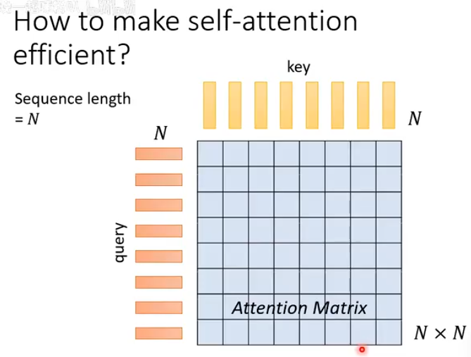

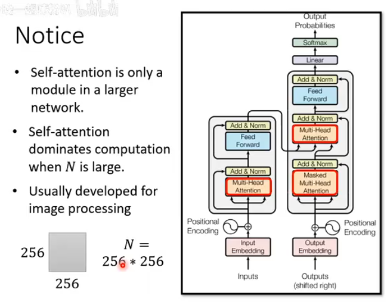

**五条路的分工**：

| 思路 | 代表 | 少了什么 |
| --- | --- | --- |
| 少算格子（人类先验） | Local / Stride / Global、Longformer、BigBird | 指定哪些格子为 0 |
| 少算格子（聚类） | Reformer、Routing Transformer | 按相似度分组 |
| 少算格子（可学习） | Sinkhorn Sorting Network | 让网络决定哪些格子为 0 |
| 降维度（低秩） | Linformer | 把 N 个 key 压成 K 个 |
| 不构造矩阵（线性化） | Linear Transformer、Performer | 换乘法顺序 |
| 不要注意力 | Synthesizer、MLP-Mixer、FNet | 连 A 都不算 |

## 1. 人类先验：Local / Stride / Global

最直接的想法：哪些格子明显不需要看？填 0 就行。

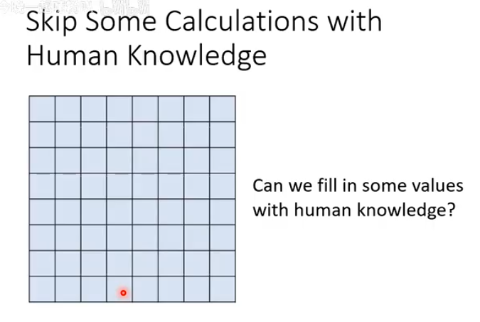

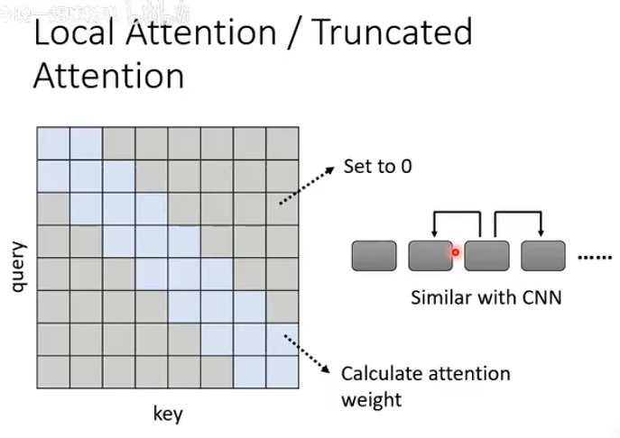

局部窗口像 CNN 的卷积核 —— 这也是「CNN = 受限感受野的 attention」这个说法的由来。

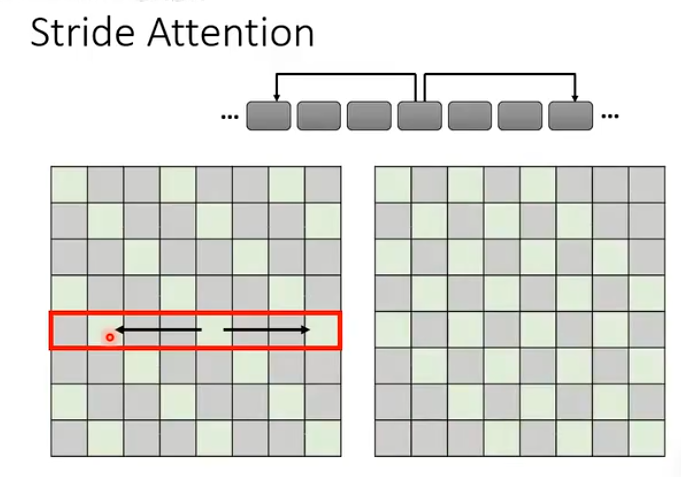

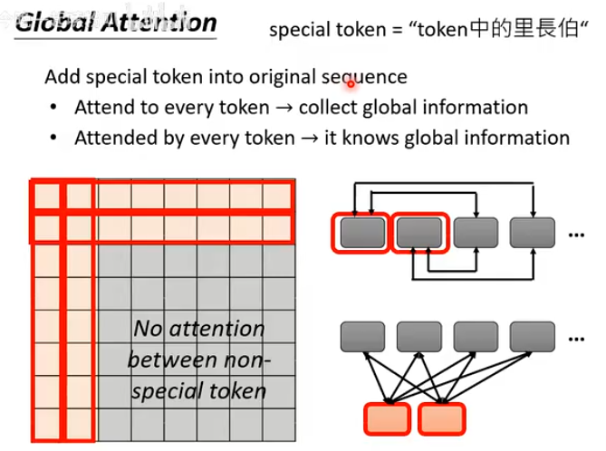

注意 Global 的实现方式很巧：加一个（或几个）**特殊 token**，它 attend 所有人、
所有人也 attend 它。这样全局信息的通路只占 `2N` 个格子，而不是 `N²`。

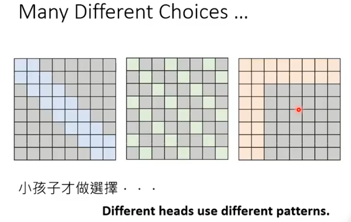

这张图是整节的关键：**pattern 不互斥**。一个 head 管局部、一个管跨步、一个管全局，
混着来比全用同一种划算。Longformer / BigBird 就是这么组装的。

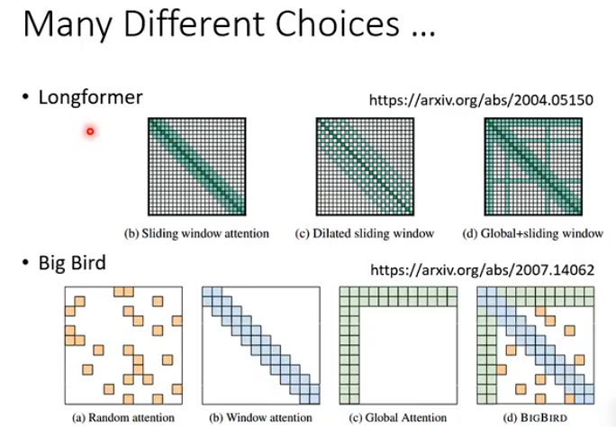

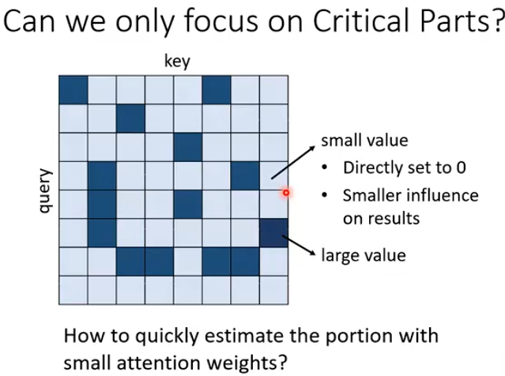

## 2. 聚类：先分组，只算同组

先按相似度把 query 和 key 分簇，只保留「同一个簇」的格子。

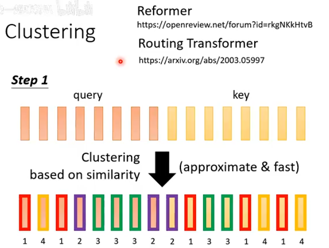

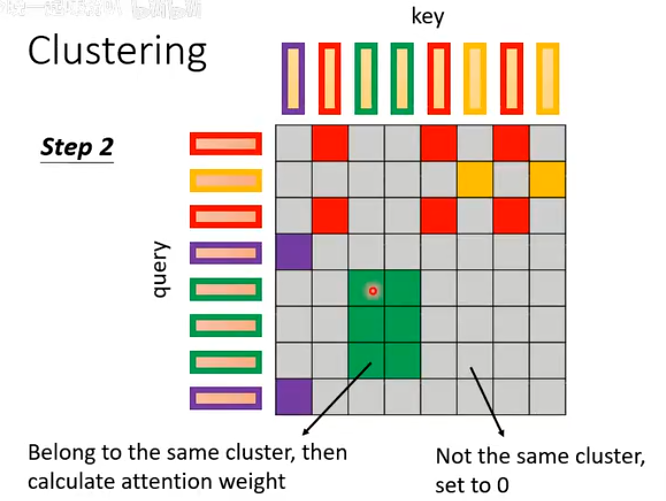

代表：Reformer（LSH 聚类）、Routing Transformer（k-means）。

代价有两个，都容易被忽略：
- 聚类本身的开销可能比省下的还大（**实测：k-means 让整体慢 6 倍**）
- 分组是近似的，该看的 pair 可能被分到不同簇

## 3. 可学习 pattern：Sinkhorn Sorting Network

既然要选哪些格子留、哪些丢，不如**让网络自己学**。

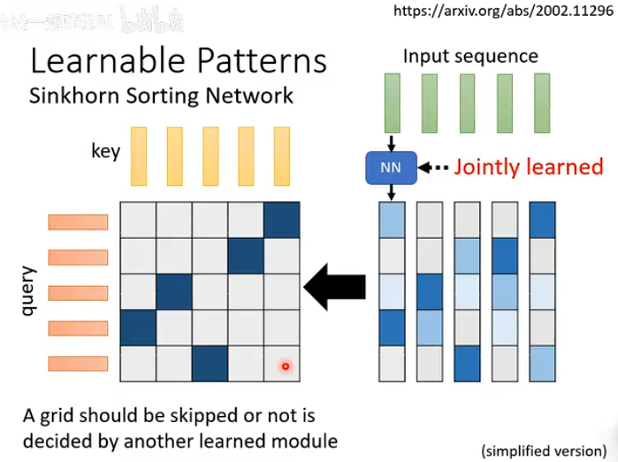

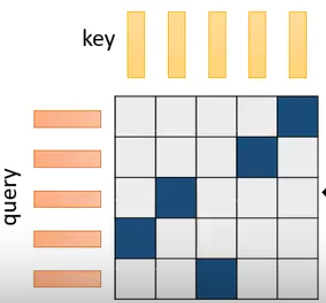

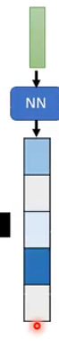

思路：输入序列 → 一个 NN → 输出一个「排序/选择」矩阵 → 得到稀疏 pattern。
关键要求是可微（用 Sinkhorn 归一化做软排序），否则梯度传不回去。

## 4. 低秩：Linformer

课件的观察：注意力矩阵里**很多列其实是别的列的线性组合**。

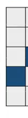

于是不需要 N×N，只需要 N×K：从 N 个 key 里挑（或算出）K 个有代表性的。

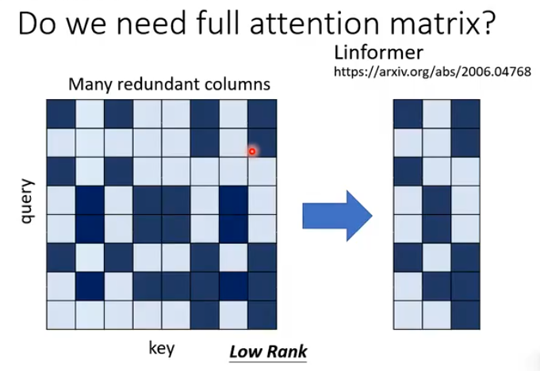

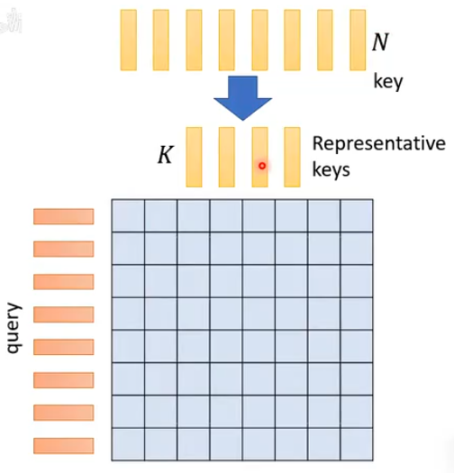

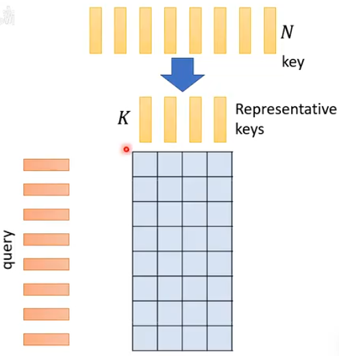

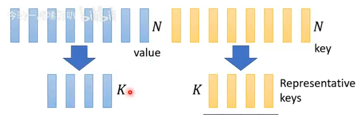

N 个 key 能缩短，N 个 query 也能 —— 但**减少 query 会改变输出序列长度**，
所以一般只压 key（编码器场景）。

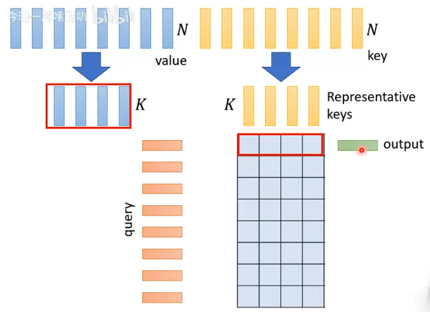

实现上有两种：Compressed Attention（用卷积把相邻几个 key 压成一个）、
Linformer（用一个 `K×N` 的投影矩阵做线性组合）。

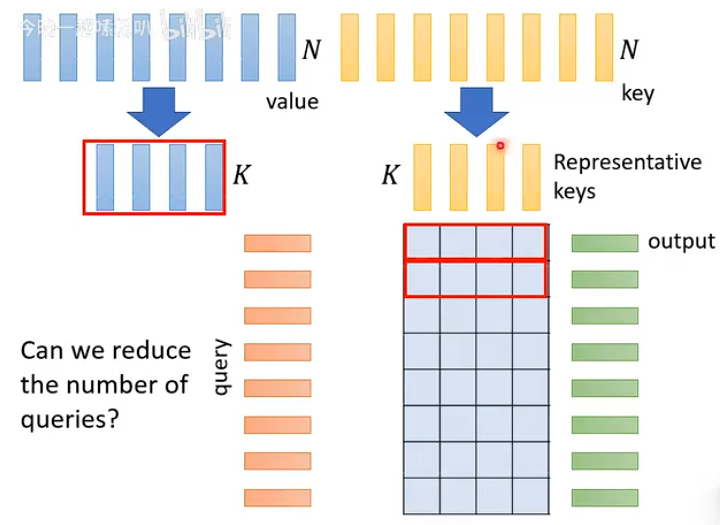

### 但我们实测：低秩这个前提，在随机权重下不成立

把真实的注意力矩阵拿出来做 SVD，看奇异值谱：

| | 前 8 个归一化奇异值 |
| --- | --- |
| 随机 k | 1.0, 0.279, 0.271, 0.268, 0.258, 0.244, 0.238, 0.226 |
| k 落在 4 维子空间 | 1.0, 0.865, 0.798, 0.693, 0.669, 0.627, 0.562, 0.496 |

谱几乎是平的 —— 也就是说**随机初始化时注意力矩阵是满秩的**。重构误差：

| 保留 K 个奇异值 | 随机 k | 4 维子空间的 k |
| --- | --- | --- |
| 4 | 73.8% | 71.3% |
| 8 | 67.6% | 51.8% |
| 32 | **42.4%** | **12.7%** |
| 128 | 11.9% | 0.2% |

**结论：低秩是训练出来的经验性质，不是 softmax 的数学推论。**
Linformer 论文那张谱图是从训练好的模型里抽的，用随机权重验证不了它。

这一条很重要：它解释了为什么这些高效 attention 论文都强调「同算力重训」——
它们赌的是**训练会把注意力矩阵压成低秩**，而不是「任意矩阵都能压」。

## 5. 线性化：忽略 softmax，换乘法顺序

这是全套里最漂亮的一招，也是唯一**严格等价**的。

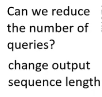

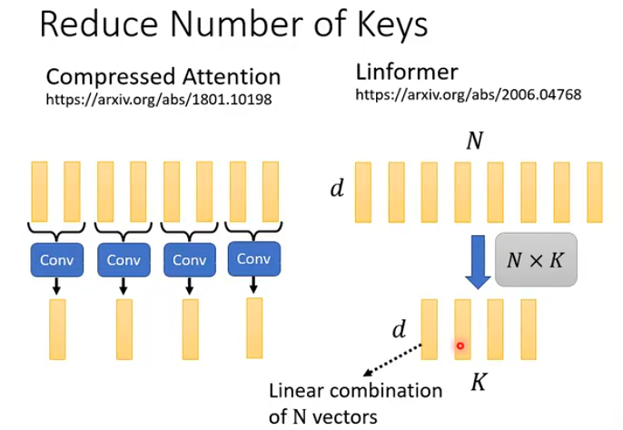

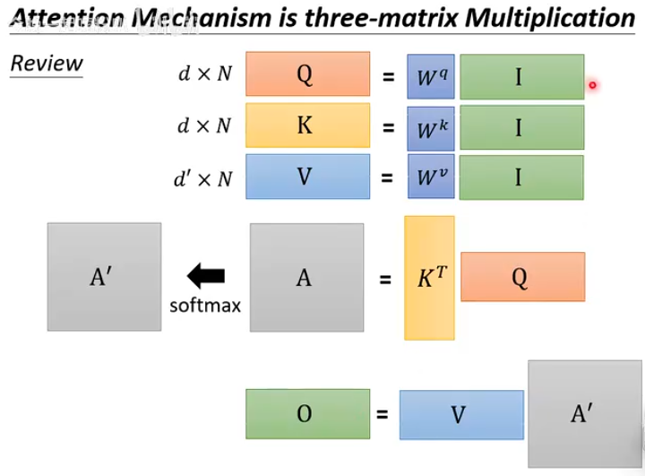

先看纯代数的例子（`k=1, m=1000, n=1, p=1000`）：

| 写法 | 中间结果 | 乘法次数 |
| --- | --- | --- |
| `A(CP)` | `CP` 是 1000×1000 | 1,001,000 |
| `(AC)P` | `AC` 是 1×1 | **2,000** |

结果一样，算力差 500 倍。这个「先算小矩阵」的原则就叫**结合律优化**。

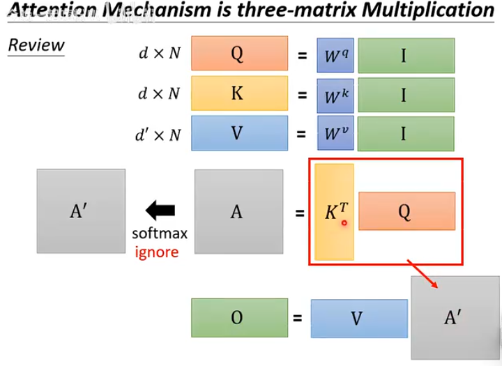

用回 attention：

| 写法 | 复杂度 | N=4096, d=d'=64 的 FLOPs |
| --- | --- | --- |
| `V(KᵀQ)` | `(d+d')N²` | 2.1e9 |
| `V(Kᵀ)Q` | `2dd'N` | **3.4e7**（小 64 倍） |

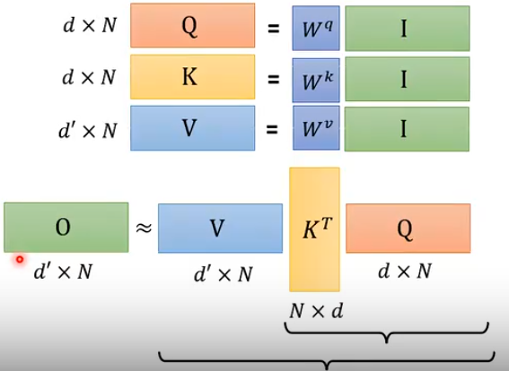

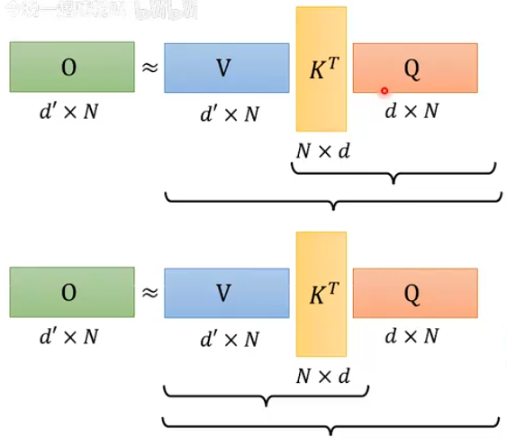

**实测（N=2048）**：两种写法的相对误差 `4.4e-07`（纯浮点误差，数学上相等），
耗时 9.34 ms → 0.39 ms，快 **24 倍**。

### 但 softmax 怎么办

`softmax` 是非线性的，一加回来就不能换顺序了。所以要做近似：
`exp(q·k) ≈ φ(q)·φ(k)`，取 `φ(x) = elu(x)+1`。

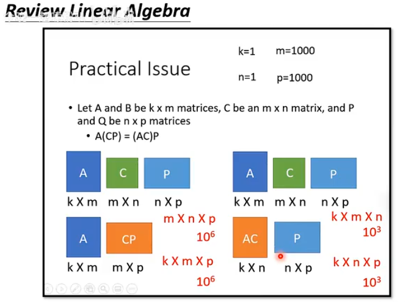

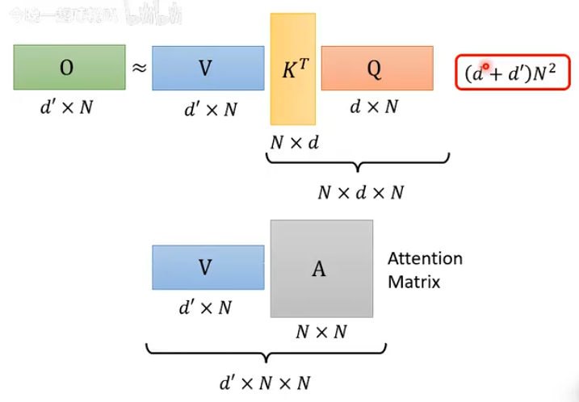

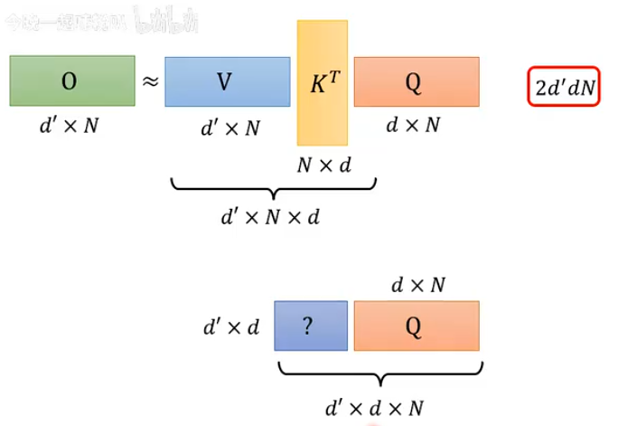

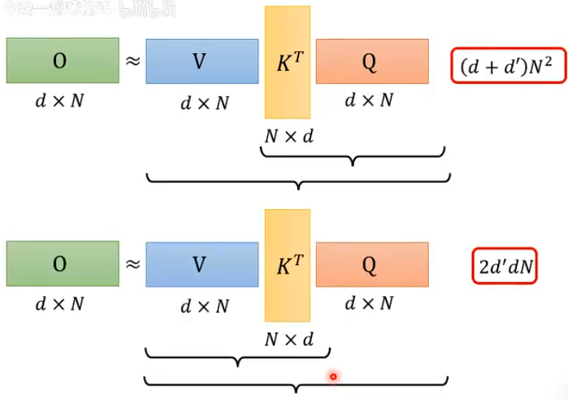

**实测误差：77.6%**（N=512, d=32，随机权重）。这个数字不小 —— 因为 `exp` 是强非线性，
`elu+1` 只在 0 附近像它。

这正是这类方法的真相：**不是换模块，是换训练目标**。论文里「效果不掉」的前提都是重训。

### 「算过一次就不用再算」

最后一组图讲的是实现层面的复用：`b¹` 的分子拆成 M 个「第 i 维的加权和」，
这 M 个向量**对所有 query 都一样**，算一次就够了。

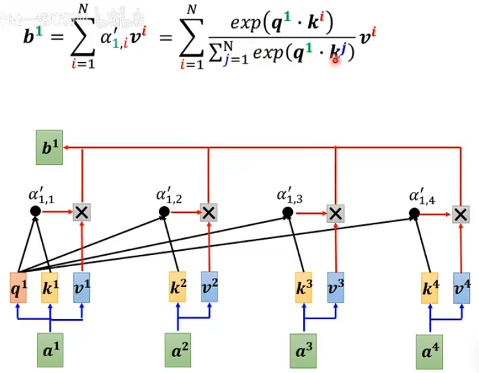

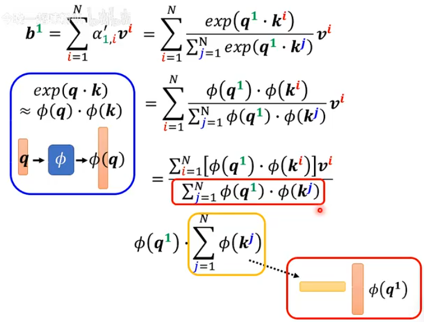

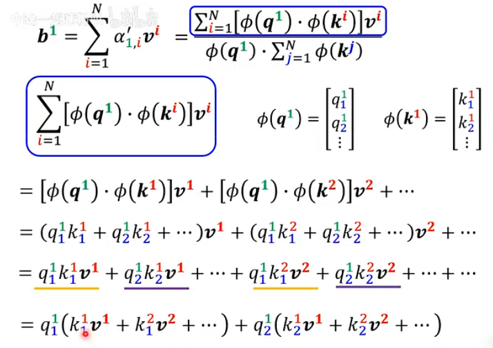

这就是从 `O(N²)` 真正落到 `O(N)` 的实现细节：把「按 query 逐个算」变成
「先算一份与 query 无关的汇总，再让每个 query 去查表」。

## 6. 干脆不要注意力

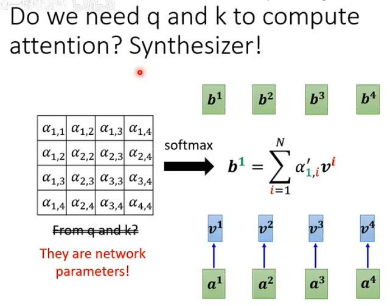

`Synthesizer` 把 A 变成一个**可学习参数矩阵**，完全不算 `q·k`。
实验上在很多任务里也能打 —— 这逼着我们重新想：attention 里到底哪部分是必要的？

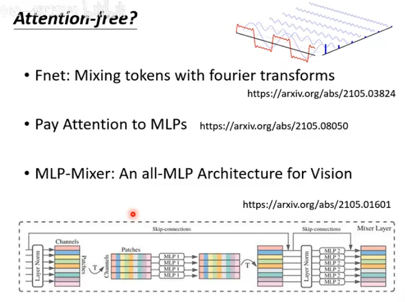

- **FNet**：用傅里叶变换替代 self-attention
- **MLP-Mixer**：全 MLP，token 之间只靠转置后的 MLP 混合
- **Pay Attention to MLPs (gMLP)**：用门控 MLP 做 token 混合

## 7. 汇总：怎么选

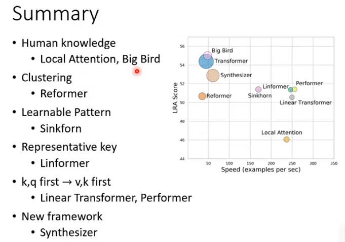

| 方法 | 复杂度 | 代价 | 什么时候用 |
| --- | --- | --- | --- |
| full attention | `O(N²)` | — | 基线，N < 512 时根本不值得优化 |
| local / stride / global | `O(N·w)` | mask ≠ 加速，要稀疏 kernel | 长文本、语音、图像 |
| 聚类 | 近似 `O(N log N)` | 聚类开销可能更贵 | 长序列检索类任务 |
| Sinkhorn | `O(N·K)` | 要额外网络 + 可微排序 | 想学 pattern 时 |
| Linformer（低秩） | `O(N·K)` | 低秩假设要靠训练成立；E 有 N×K 参数 | 编码器、固定长度 |
| Linear / Performer | `O(N)` | 必须重训，近似误差大 | 超长序列 |
| Synthesizer / MLP-Mixer | `O(N)` | 丢掉 q-k 交互 | 探索性研究 |

### 三条现实提醒

1. **mask ≠ 加速**。我们实测：置 0 了 87% 的格子，耗时反而从 2.87ms 涨到 6.33ms ——
   因为「先算满再置 0」，计算一步没省，还多了 mask 开销。稀疏 attention 必须有配套 kernel。
2. **「效果不掉」都是同算力重训的结果**。直接替换模块，误差可以到 40%~78%。
3. **先确认 N² 真的是瓶颈**。N < 512 时 self-attention 常常不是主要开销，
   优化它是白费力气 —— 先上 profiler 再动手。

## 8. Q&A

**Q：为什么不能直接「把 softmax 拿掉」？**
A：能，但要重训。softmax 提供的是「权重归一化 + 稀疏化」，拿掉之后输出尺度会变、
模型行为完全不同。线性 attention 做的就是「换一种归一化（除分母）再重训」。

**Q：局部窗口和 CNN 有区别吗？**
A：本质是同一件事（受限感受野）。区别在于 attention 的权重是**内容相关**的，
CNN 的权重是**位置固定**的。所以 attention 在同样的窗口内能挑重点，CNN 不能。

**Q：低秩和线性化能叠加吗？**
A：能。很多模型同时用「压 key」和「换顺序」。实际的加速往往来自多个技巧叠加，
而不是单一方法。

**Q：这些方法在 GPU 上真的更快吗？**
A：不一定。理论 FLOPs 少，但如果 kernel 写得不好（内存访问不连续、mask 开销大），
实测可能更慢。论文里的加速数字都依赖它们自己的 CUDA 实现。

## 9. 对应代码

```bash
python main.py efficient_attention
```

`efficient_attention/model.py` 五个实现 + 复杂度公式 + SVD 工具，
`efficient_attention/demo.py` 六节：N² 成本 / 换顺序 / φ 近似 / 稀疏化 / 低秩 / 汇总。
