# 08 · GAN

> 一句话：不定义「哪个答案对」，只训一个裁判判断「像不像」，然后让生成器去骗它。

## 1. Network as Generator

普通的 network 是「一个输入 → 一个输出」。Generator 多了一个东西：**额外的随机输入 z**。

```
x（条件，可省略） ┐
                  ├─→ Network → y（落在复杂的分布里）
z ~ 简单分布      ┘
```

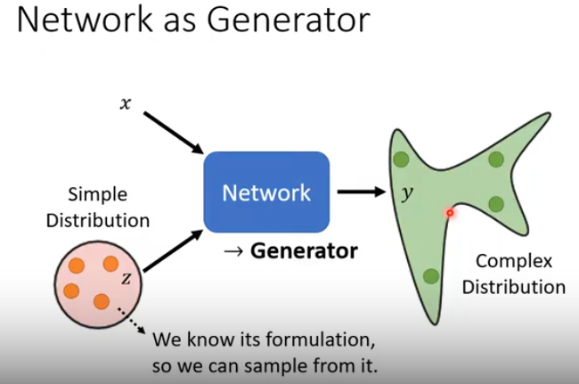

`z` 的分布必须是**已知且好采样**的（通常就是标准正态）。网络负责把它「摊开」成数据分布。
这样每次采样 z，就得到一个不同的 y —— 这才是「生成」。

## 2. 为什么需要分布

因为很多任务的正确答案**本来就不唯一**。

| 任务 | 同一个输入 | 合理输出 |
| --- | --- | --- |
| 画红眼角色 | 「红眼睛的角色」 | 无数张 |
| 聊天机器人 | 「你知道辉夜是谁吗」 | 多种回答 |
| 视频预测 | 前几帧 | 多种后续 |

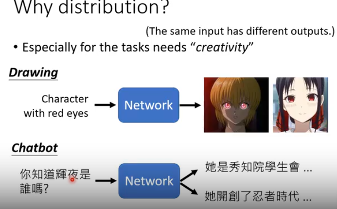

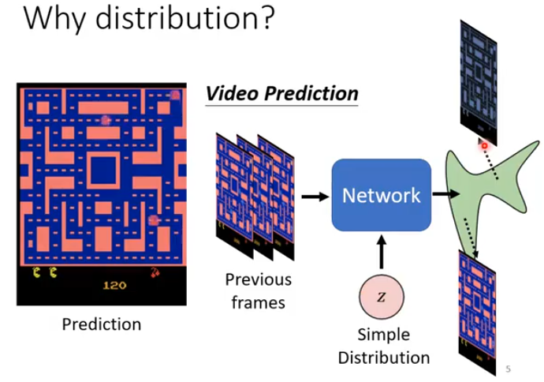

### 用 MSE 会怎样：实测

造一个一维双峰数据：`y = +2` 和 `y = -2` 各一半。用 MSE 训一个 MLP：

| 输入 x | 网络输出 | 真实数据里只有 |
| --- | --- | --- |
| -0.8 | +0.035 | +2 或 -2 |
| 0.0 | -0.099 | +2 或 -2 |
| +0.8 | -0.203 | +2 或 -2 |

**网络输出了 0 —— 一个从来没在数据里出现过的值。**

因为 MSE 的最优解是**条件均值**。两个峰的平均就是中间那个"空谷"。
图像糊、语音平、视频预测出鬼影，都是同一个原因。

所以：要生成，就得学**分布**，从分布里采样，而不是取均值。

## 3. Discriminator

一个普通的分类网络，只是输出一个标量：

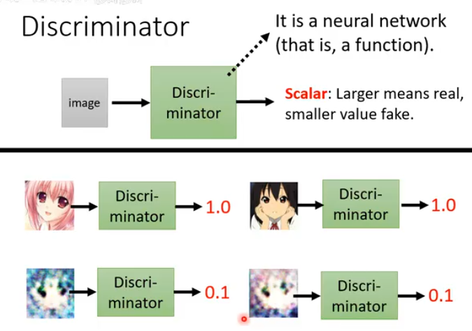

- 输入：一张图（真的或假的）
- 输出：一个 scalar，**越大越像真的**
- 它不知道「怎么生成」，只负责挑刺

训练它很直接：真图标签 1，假图标签 0，二分类。

## 4. 训练：两步交替

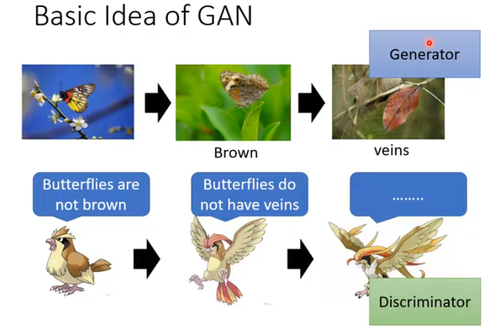

课件的进化比喻很贴切：generator 是物种，discriminator 是环境。
物种变异（v1 → v2 → v3），环境也跟着变难（D v1 → v2 → v3）。

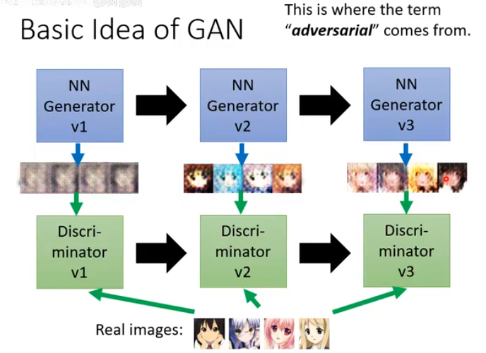

### Step 1：Fix G，update D

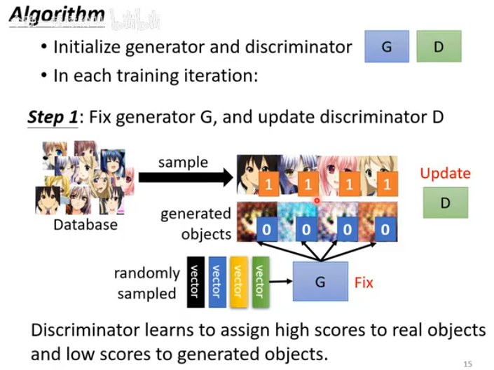

- 真图 → 标签 1，假图（G 生成）→ 标签 0
- 只更新 D 的参数
- 实现关键：`fake = g(z).detach()` —— **不 detach 的话 D 的梯度会顺手改掉 G**

### Step 2：Fix D，update G

这是你问的「骗到底怎么操作」，课件这张图讲得最清楚：

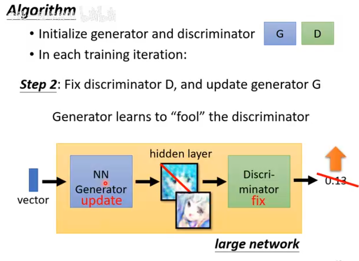

**做法：把 G 和 D 串成一个 large network，中间那层的输出就是一张图。**

```
z → [ G ] → 样本 → [ D ] → 分数
      ↑ 可训练      ↑ 冻结
```

然后把这个大网络当成一个普通的网络来训：希望输出分数**越大越好**。
但优化器里只放 G 的参数，所以 D 一个数都不会变。

代码就三行：

```python
loss = bce(d(g(z)), ones)      # 把 G 的输出喂给 D，标签谎报成「真」
opt_g.zero_grad(); loss.backward(); opt_g.step()
```

### 实测：验证「只动 G」

| 阶段 | G 参数变化 | D 参数变化 | 结果 |
| --- | --- | --- | --- |
| Fix G, update D（300 步） | **0.00e+00** | 变了 | D(真)=0.997，D(假)=0.003 |
| Fix D, update G（300 步） | 变了 | **0.00e+00** | G 的平均分数 0.003 → 1.000 |

两个 `0.00e+00` 就是"冻结"这件事的硬证据。

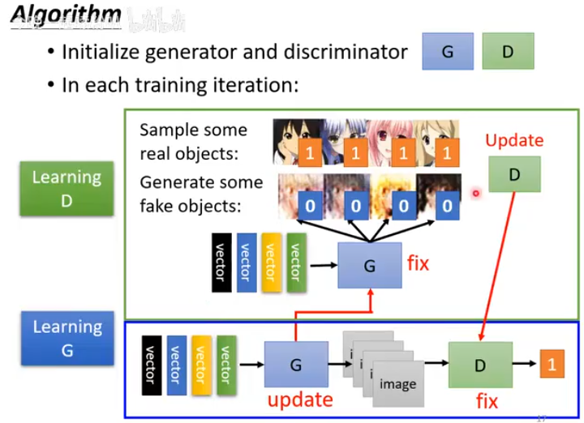

### 一个必须知道的坑：非饱和损失

原始论文写的是 `min log(1 - D(G(z)))`。问题：当 D 很强（`D(G(z))≈0`）时，
这个 loss 的梯度**接近 0**，G 学不动。

工程上几乎都用等价改写（叫 non-saturating loss）：

```python
loss_G = -log(D(G(z)))     ≡  bce(d(g(z)), 1)
```

数学上梯度方向一致，但在 D 强的时候梯度不会消失。

另外注意：上面 Step 2 里 G 的分数从 0.003 冲到 **1.000** —— 因为 D 被冻住了 300 步，
G 有足够时间找到 D 的盲点。这正好说明**为什么必须交替**：一直对着一个固定裁判练，
练出来的不是"真"，是"钻空子"。

## 5. 训练结果：圆环

目标分布是一个半径 1 的圆环（真实数据只有环上有点）。训练 2000 步后：

```
训练前                          训练后
o = 真数据                      @ = 重合
..o....                         ....@o@o@@@@@@.@o...
.o.o.o..                        .@@@@@xo.......o.x.@@@
....xx....                      o@@@................oo@@
                                oo@x.........x......oo@
```

生成的点基本铺到环上了。两个分数也说明训练是健康的：

| step | D(真) | D(假) |
| --- | --- | --- |
| 500 | 0.535 | 0.505 |
| 1000 | 0.498 | 0.496 |
| 2000 | 0.500 | 0.500 |

**两个都稳在 0.5 附近才是对的** —— 这就是 "adversarial" 的本意：不是谁赢，是一直僵持。

## 6. 演进：从鬼画符到认不出来

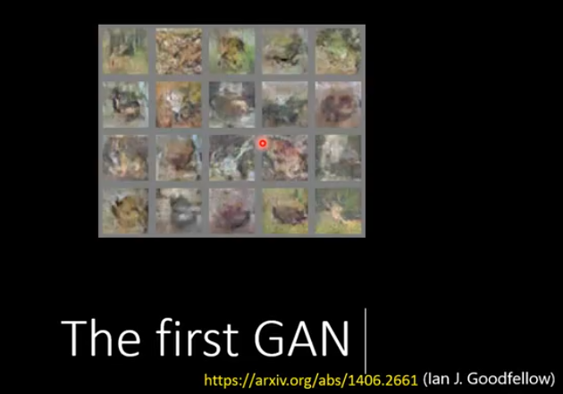

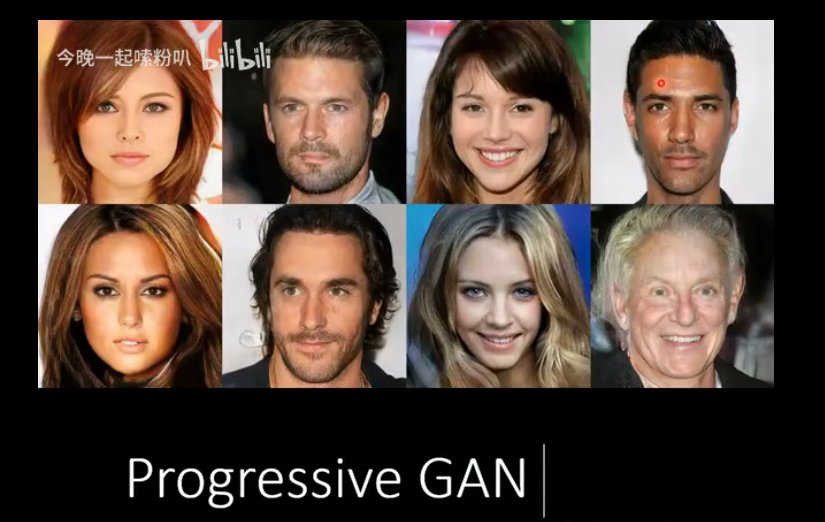

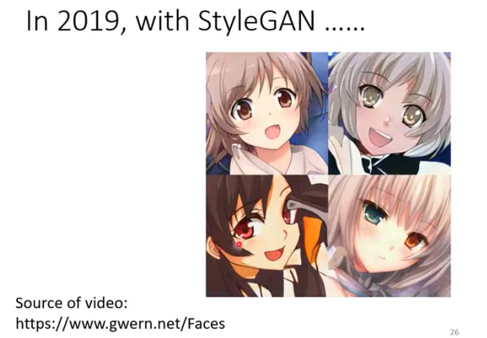

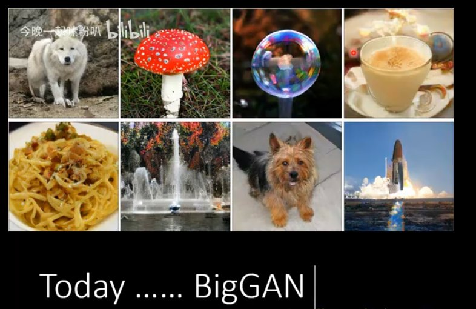

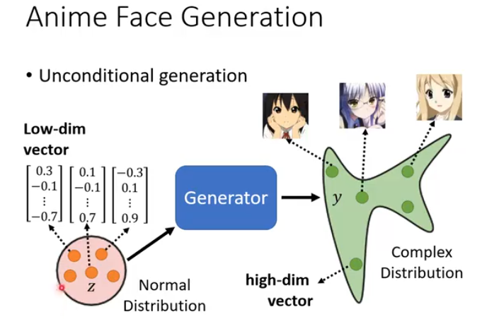

还有个好玩的验证：把 `z` 从 `[0,0]` 慢慢插值到 `[0.9,0.9]`，生成的图片是**连续变化**的
（头发、表情、朝向平滑过渡）。这说明 G 学到的是一个连续的空间，不是几张孤立的脸。

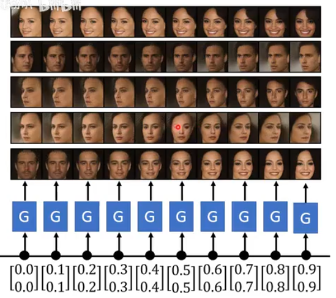

GAN 的变体多到需要一张表来记：

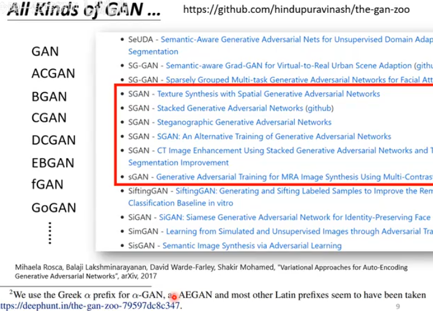

## 7. 诚实说：GAN 不好训

圆环那个结果是挑出来的。常见故障：

| 故障 | 表现 | 原因 |
| --- | --- | --- |
| 模式崩塌 | G 只画同一张脸 | 反正 D 分不出来，没必要多样 |
| D 太强 | G 的 loss 不降，样本不变 | 梯度消失 |
| D 太弱 | G 随便画都能过 | 学不到真实分布 |
| 超参敏感 | 换数据集就得重调 | lr / betas / D:G 比例 |

所以后来有了 WGAN（换距离度量）、StyleGAN（换生成器结构），
以及 diffusion —— 不是因为 GAN 不行，是因为它**太依赖那个平衡**。

## 8. 「幻想」：它学的是「像」，不是「对」

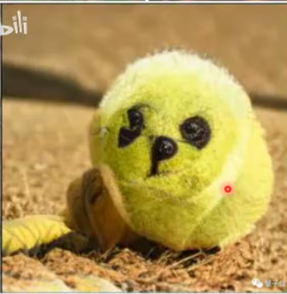

这张图是这节最好的收尾。人脑会在网球和叶子上看出脸 —— 因为我们的视觉系统
被"人脸"这个 pattern 训练得太敏感了，看见两个点一条线就自动补全。

GAN 的 discriminator 有同样的问题：**它判断的是「像不像真的」，不是「对不对」**。
所以 G 完全可能学到「纹理很像、结构全错」的东西 —— 六根手指、融化的背景、
左右不对称的耳环，都是这么来的。

这也是后来评价指标（FID、IS）和结构先验（pose、depth、segmentation 条件）存在的原因：
**「像」这个目标本身不够。**

## 9. Q&A

**Q：z 为什么必须是简单分布？**
A：因为你得能采样。而且 G 只需要把**一个**连续分布映射过去，难点都交给网络了。
理论上任何连续分布都行，实践中用标准正态是因为它各向同性、采样便宜。

**Q：「把 G 和 D 接起来」的时候，梯度不会把 D 改坏吗？**
A：不会 —— 只要优化器里只有 G 的参数。但要注意 D 必须是 `eval` 语义（BN 的统计别被这批假数据带偏），
实战里通常直接冻 D 的参数。

**Q：G 的 loss 用 `-log D(G(z))` 和 `log(1-D(G(z)))` 有什么区别？**
A：前者是非饱和版，D 很强时梯度不消失；后者是原论文形式，容易卡住。
两者最优解相同，训练动力学不同。

**Q：GAN 和 diffusion 的关系？**
A：都在学「从噪声到数据」的映射。GAN 一步到位，靠对抗学；diffusion 分几百步，
靠去噪目标学。diffusion 更稳但更慢，这也是它后来居上的原因。

## 10. 对应代码

```bash
python main.py gan
```

`gan/model.py`（Generator / Discriminator / 圆环分布 / 字符图），
`gan/demo.py` 五节：为什么需要分布 / 两个网络 / 两步交替 / 训练圆环 / 不稳定性。
