# 09 · GAN 的理论：Divergence、JS 的死穴、WGAN

> 一句话：生成任务要 minimize 的是**两个分布的差异**，但这个差异算不出来；
> GAN 用一个判别器去**估**它，而这个估计（JS）在分布不重叠时会退化成一个常数。

## 1. 目标：minimize 的不是 loss，是 divergence

普通训练：

```
w*, b* = arg min L        L 是人定的（MSE / 交叉熵）
```

生成训练：

```
G* = arg min Div(P_G, P_data)
```

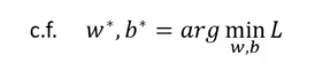

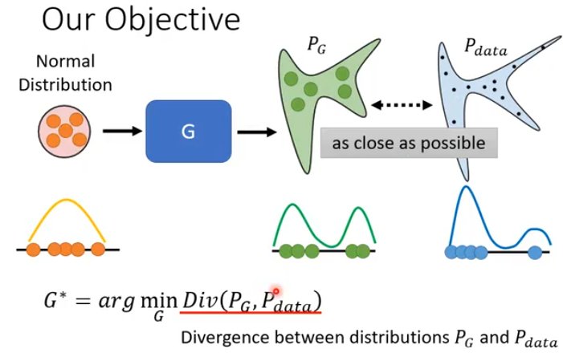

区别在于：`L` 是**你写的**，`Div` 是**你不知道怎么算的** ——
`P_data` 和 `P_G` 都只有样本，没有解析形式。

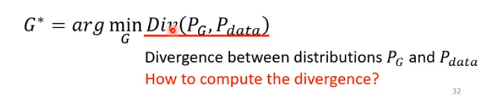

## 2. 只有样本也能算

虽然不知道分布的公式，但**可以从里面采样**。这就够了。

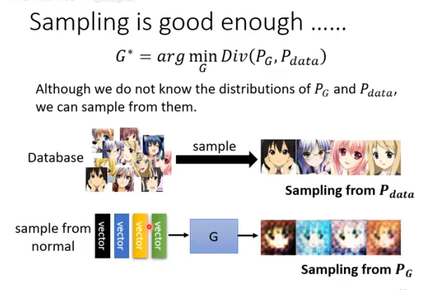

GAN 的全部技巧就在这一步：不去算两个分布的距离，而是**训练一个分类器去区分它们**。

## 3. D 的 max 值就是 divergence

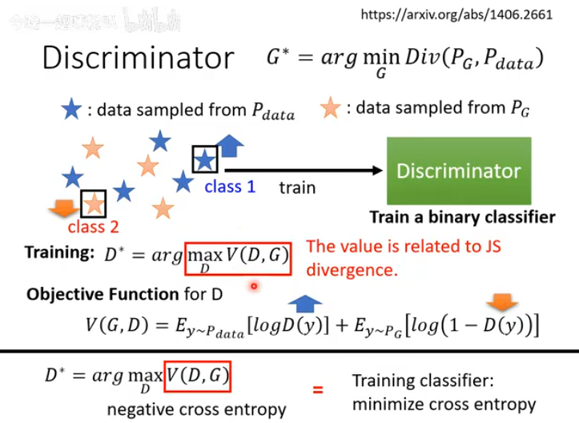

```
V(D, G) = E_{x~P_data}[log D(x)] + E_{x~P_G}[log(1 - D(x))]

D* = arg max_D V(D, G)        ← 这是「训练判别器」
```

关键结论：**`max_D V` 和 JS divergence 有确定的关系**。

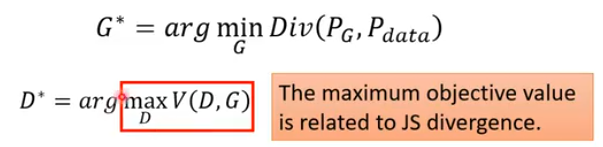

### 实测验证

`P_data ~ N(0,1)`，`P_G ~ N(1.5,1)`，在同一个 bin 网格上离散化：

| 量 | 值 |
| --- | --- |
| `JS(P_G ‖ P_data)` | 0.4720 |
| `2·JS - 2log2` | **-0.9440** |
| `max_D V(D)`（代最优 D） | **-0.9440** |
| `min_D V(D)`（代最差 D） | -3.1970 |

两个 -0.9440 完全相等 —— 这就是课件说的「最大值和 JS 有关」，具体是
`max_D V = 2·JS - 2log2`。

> 顺带一个易错点：理论最优的 D 是**逐点的** `D*(x) = p_data(x)/(p_data(x)+p_G(x))`，
> 是个 0~1 之间的概率，不是 0 或 1。所以「D 输出 1.0 = 绝对真」只在有限容量下近似成立。

**为什么 D 要 max？** 因为给定任意 D，`V(D)` 都是真实差异的一个**下界**。
D 训得越好，下界越紧。D 没训好，你量出来的"差异"就是错的 —— 这也是 GAN 训练不稳定的根源之一。

## 4. min-max：一个套着的优化问题

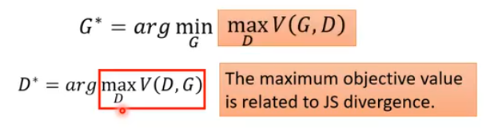

```
G* = arg min_G  max_D  V(D, G)
```

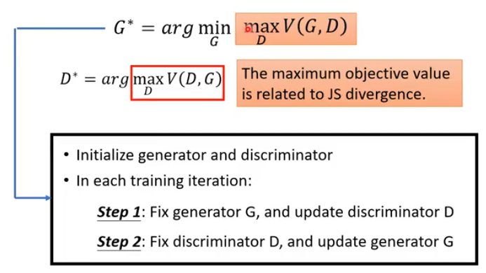

内层 `max_D` 是「把裁判训好」，外层 `min_G` 是「让生成器去骗」。

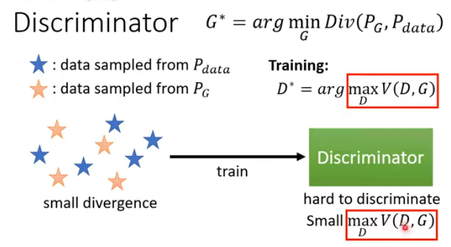

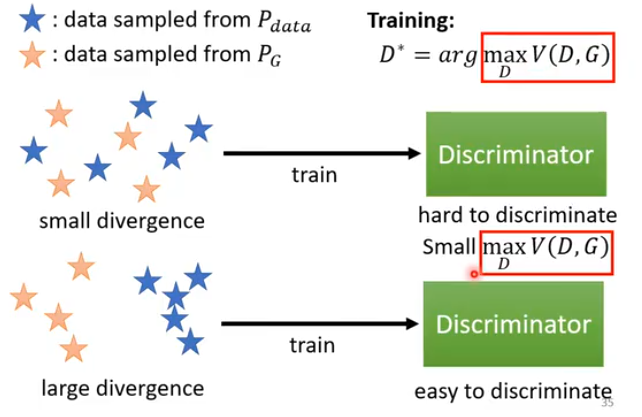

这张对照图很值得记住：**`max V` 小 = 两个分布像，`max V` 大 = 差得远**。
所以 G 要往「让 max V 变小」的方向走。

## 5. f-GAN：divergence 可以随便换

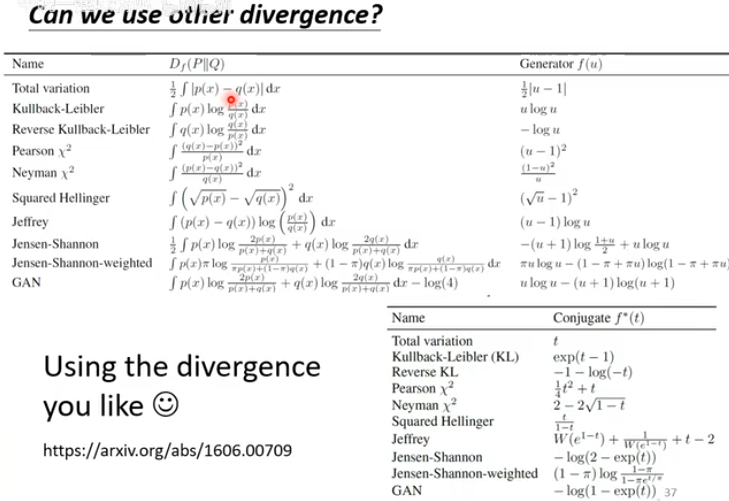

常见的几种（同一对分布上的实测值）：

| Divergence | 定义 | 特点 |
| --- | --- | --- |
| KL | `Σ p log(p/q)` | **不对称**，`KL(p‖q) ≠ KL(q‖p)` |
| JS | `0.5·KL(p‖m) + 0.5·KL(q‖m)`，`m=(p+q)/2` | 对称，有上界 `log2` |
| Total Variation | `0.5·Σ\|p-q\|` | 有界，但经常是常数（0 或 1） |
| Hellinger | `sqrt(0.5Σ(√p-√q)²)` | 有界 |
| Wasserstein | 搬土的平均距离 | **不重叠也有梯度** |

`f-GAN`（arXiv 1606.00709）证明：只要选一个凸函数 `f`，就能构造对应的 GAN 目标。
所以「用哪种 divergence」是一个可以选的设计变量 —— 不是必须用 JS。

## 6. JS 的死穴

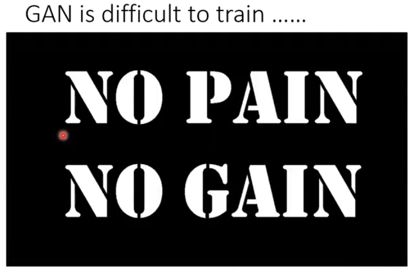

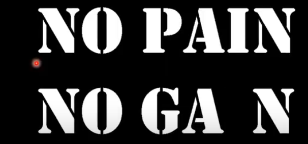

真正的问题不是"难训"，而是 **JS 本身在关键时刻没有信息**。

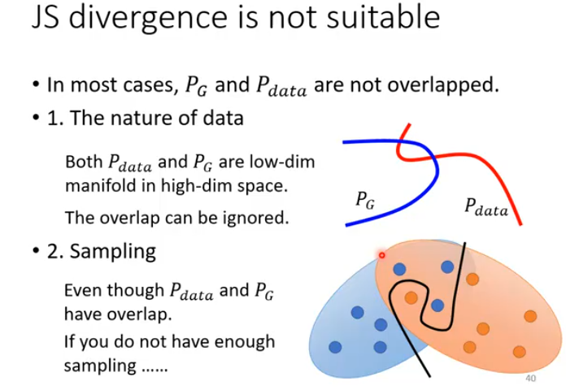

两个原因：

1. **数据本身的性质**：`P_data` 和 `P_G` 都是高维空间里的低维流形，两条流形几乎不可能相交
2. **采样有限**：就算理论上有重叠，采到的点也碰不上

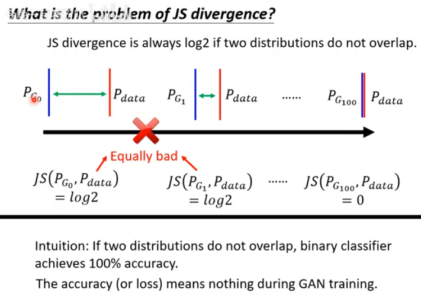

### 实测：JS 是平台，Wasserstein 是斜坡

`P_data ~ N(0,1)`，`P_G ~ N(θ,1)`，只改 θ：

| θ | JS | Wasserstein | dJS/dθ |
| --- | --- | --- | --- |
| 10.0 | 0.6931 | 10.0002 | — |
| 6.0 | 0.6893 | 6.0001 | **+0.0010** |
| 4.0 | 0.6327 | 4.0001 | +0.0283 |
| 2.0 | 0.3368 | 2.0000 | +0.1479 |
| 1.0 | 0.1114 | 1.0000 | +0.2254 |
| 0.0 | 0.0000 | 0.0000 | +0.1114 |

**θ 从 10 降到 6，JS 只动了 0.004，斜率 ≈ 0.001；而 Wasserstein 从 10 掉到 6，一路线性。**

这就是问题所在：θ=10 和 θ=6 的生成器，在 JS 眼里"一样差"，
**G 收不到任何梯度信号**，根本不知道往哪走。

## 7. Wasserstein：换个度量

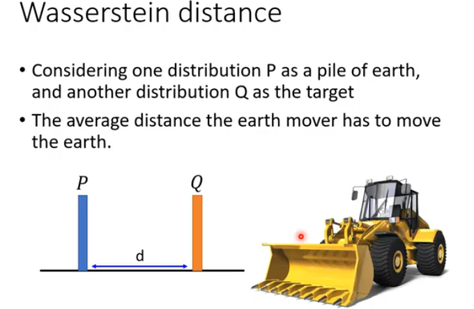

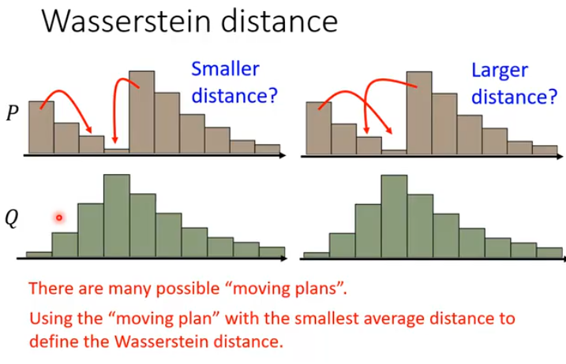

直觉：不要求两个分布重叠，只问「把它们搬到一起要费多大劲」。
分布离得越远，费力越多 —— **即使完全不重叠，这个数也随距离线性变化**。

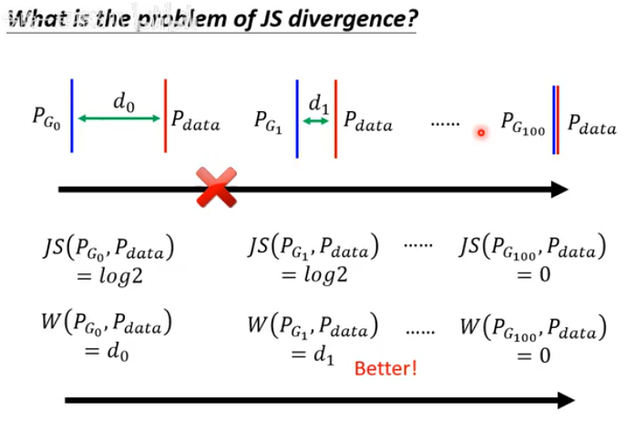

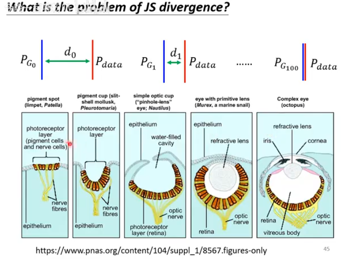

那张眼睛演化的图是这一节最好的比喻：JS 只会说"你还没长出眼睛"，
Wasserstein 会说"比上一代好一点" —— 前者没有梯度，后者有。

## 8. WGAN 与 Lipschitz 约束

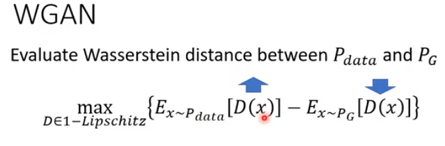

```
max_{D ∈ 1-Lipschitz}  E_pdata[D(x)] - E_pG[D(x)]
```

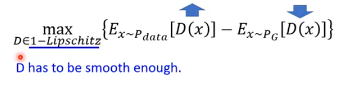

没有这个约束，D 会把真数据推到 +∞、假数据推到 -∞，差值无限大 —— 训练不收敛。

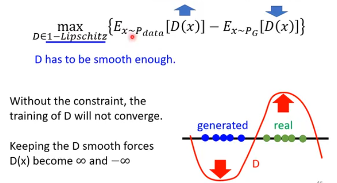

### 实测：三种约束的差别

真实数据集中在 `0`，生成的全在 `2`（完全不重叠），真实 `W1 = 2`：

| 约束 | `max\|dD/dx\|` | `E[D(真)]-E[D(假)]` | 说明 |
| --- | --- | --- | --- |
| 无约束 | **531,864** | 702,062 | D 变成极陡的阶跃 |
| 权重裁剪 ±0.05 | 0.46 | 0.574 | 有界，但**不等于 W1** |
| 梯度惩罚 (GP) | **1.10** | **2.198** | 梯度≈1，差值≈W1=2 |

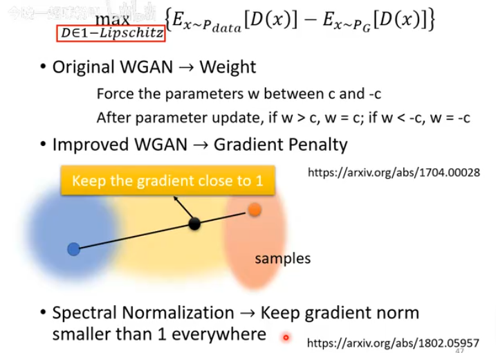

| 方法 | 做法 | 问题 |
| --- | --- | --- |
| 权重裁剪（原版） | 每步把参数夹到 `[-c, c]` | Lipschitz 常数说不清，所以估出来的不是真 W1 |
| 梯度惩罚（WGAN-GP） | 罚 `(‖∇D‖-1)²` | 慢一些，但约束准确 |
| 谱归一化（SN-GAN） | 每层权重除以最大奇异值 | 便宜，能控制上界 |

所以「WGAN 能算 Wasserstein 距离」这句话有前提：**约束必须真的把 Lipschitz 常数压到 1**。
权重裁剪只能算个大概 —— 上面第二行差值 0.574、第三行 2.198，差了三倍多，这就是证明。

## 9. 理论 vs 实作：两个必须知道的偏差

课件最后那段「理论上 D 应该每次训到收敛，实际上没人这么做」，是这节最实用的部分。

**理论**：`G* = arg min_G max_D V` —— 假设每个 G 都配一个**最优**的 D。

**实作**：D 只更新几步就轮到 G，所以 D 从来不是最优的。两个补救：

| 做法 | 为什么 |
| --- | --- |
| **历史样本回放**（experience replay） | G 变了之后，D 只看当前假样本会「忘掉」以前的假样本长什么样。把旧样本也留着一起训，D 的判断更稳 |
| **D 不从零训** | D 的参数从上一个 iteration 继承，省掉重新收敛的时间。反正它本来也没收敛过 |

代价是：`max_D V` 估出来的 divergence 是个**有偏估计**。所以别把 loss 的绝对值当真 ——
它只能看趋势。

## 10. Q&A

**Q：为什么不能直接算 KL 或 JS？**
A：因为 `P_data` 和 `P_G` 都没有解析密度。只有样本时连 `log p(x)` 都算不出来。
GAN 的贡献就是给了一个「只用样本就能估 divergence」的办法。

**Q：`max_D V` 为什么不直接用？**
A：它需要 D 最优。实作里 D 只训几步，估出来的是有偏的。这就是为什么 GAN 的 loss 曲线
经常看不出问题 —— 它不是可信的"距离"。

**Q：Wasserstein 为什么不直接算？**
A：一般维度下它本身是个最优传输问题，很难算。WGAN 的价值在于：
用 Kantorovich-Rubinstein 对偶，把「算距离」变成「训一个 1-Lipschitz 的 D」，
又回到可以梯度下降的形式。

**Q：为什么 diffusion 后来更流行？**
A：它的目标（去噪）不需要对抗、不需要估 divergence，训练稳定性好太多。
代价是采样要几百步。GAN 一步出图但难训，diffusion 慢但稳 —— 这是核心取舍。

## 11. 对应代码

```bash
python main.py gan
```

第 6~8 节是本篇的内容：

- `gan/divergence.py`：KL / JS / TV / Hellinger / Wasserstein 的 1D 实现，以及 `V(D,G)`
- `gan/demo.py` 第 6 节：验证 `max_D V = 2·JS - 2log2`
- 第 7 节：θ 扫描，看 JS 平台 vs W 斜坡
- 第 8 节：三种 Lipschitz 约束的实测对比
