# 10 · 序列生成、评估、Conditional GAN

> 一句话：GAN 想扩展到文本，会遇到 argmax 把梯度掐断的问题；
> 而「生成得好不好」本身也没有一个干净的答案。

## 1. 为什么 GAN 到今天还是难

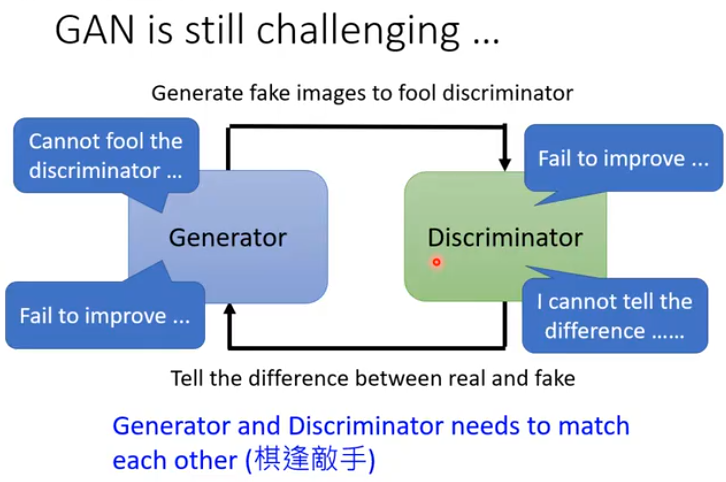

课件这张图是整节的前提：**Generator 和 Discriminator 必须棋逢敌手**。

- G 骗不过 D → G 学不到东西（"Cannot fool the discriminator"）
- D 分不出真假 → D 学不到东西（"I cannot tell the difference"）
- 任何一方压倒性胜利，训练就停滞

这不是"调参没调好"，是**目标本身是个平衡点**，不在平衡点上就没有有效的梯度。

官方的调参指南（都是工程经验，没有理论保证）：

| 来源 | 内容 |
| --- | --- |
| Soumith 的 ganhacks | 一堆经验 trick（用啥激活、怎么归一化） |
| DCGAN (1511.06434) | 网络架构设计的准则 |
| Improved Techniques (1606.03498) | 特征匹配、minibatch discrimination 等 |
| BigGAN (1809.11096) | 大 batch + 谱归一化 |

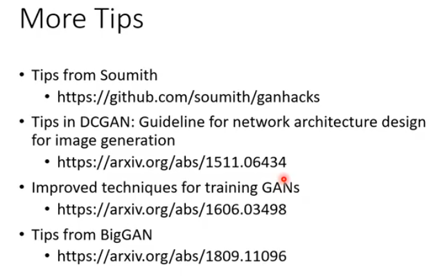

## 2. 序列生成：argmax 把梯度掐断了

这是这一讲最硬的一块，也是你复述得最准的部分。

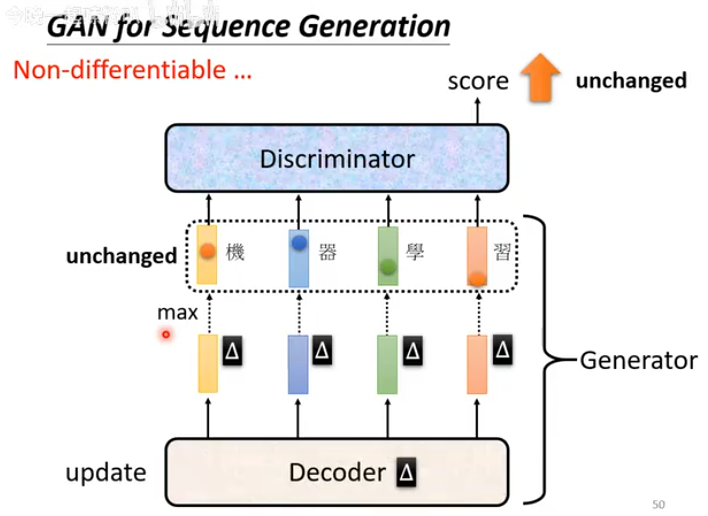

```
Decoder → logits → softmax → argmax → 离散 token → D → score
```

问题在于 **argmax 是分段常数函数**：只要第一名没换人，输入怎么变，输出一模一样。

### 实测

一个 5 词表的 toy decoder，把**第二名的 logit 提高 3.0**：

| 量 | 变化 |
| --- | --- |
| 第二名的概率 | 0.316 → **0.903** |
| 第一名（argmax） | **没变** |
| D 的打分 | **变化 0.0000000000** |
| hard 路径的梯度 | **计算图直接断掉** |
| soft 路径的梯度 | 1.24e-01 |

概率挪了 0.6，score 一点没动 —— 因为 `∂score/∂θ` 在被 argmax 切断后**恒为 0**。
这不是实现 bug，是数学性质：argmax 的雅可比处处为 0（除了测度零的边界点）。

所以对文本、语音这种**离散输出**的任务，GAN 的原始形式直接失效。

## 3. RL 的解法

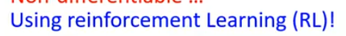

思路：绕开 argmax，用**采样**代替，然后对 **log 概率**求导。

```
采样：token ~ softmax(logits)          （不再取 argmax）
reward：D(生成的序列)                    （只当常数，不求导）
loss：- reward × log p(token)           （log p 对 θ 可导）
```

这就是 REINFORCE / policy gradient。**reward 不需要可导**，只需要能打分 ——
正好对上 GAN 里 D 的角色。

### 实测

5 词表的 toy 任务，D 最偏爱的 token 是 3：

| 量 | 训练前 | 200 步后 |
| --- | --- | --- |
| token 3 的概率 | 0.200 | **0.954** |
| D 的打分 | -0.466 | **+0.285** |

概率确实往高分 token 集中了 —— RL 这条路是通的。

代价：**方差极大**。一次只采一个样本，同一个策略可能连采五次全是低分，
梯度方向乱跳。所以要 baseline、要多次采样、要调学习率。

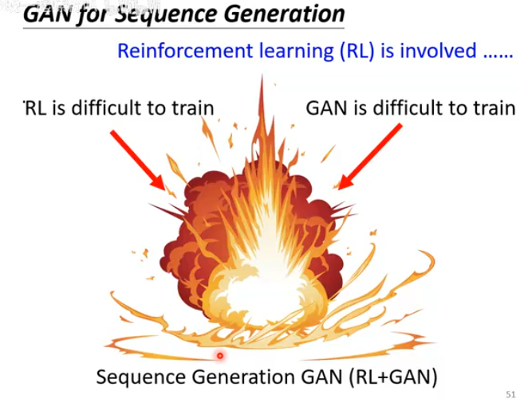

课件的爆炸图就是这个意思：**两套本来就难训的东西叠在一起**。
这就是为什么文本 GAN 一直没成为主流 —— 直到后来大家干脆换成「语言模型 + 采样温度」，
放弃了对抗这条路。

### 工程上的折中

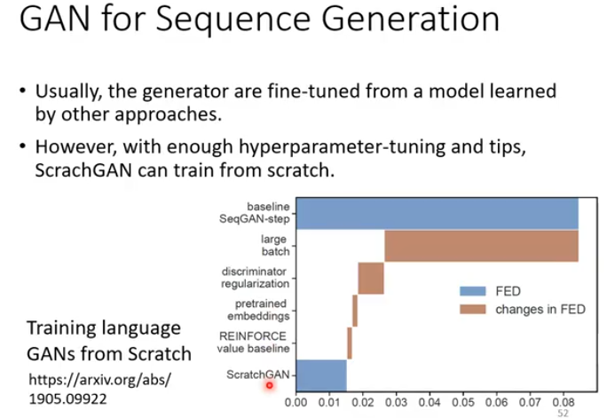

| 做法 | 说明 |
| --- | --- |
| 从别的模型微调 | 先用 MLE 训一个语言模型，再用 GAN 微调 —— 不从零开始 |
| ScratchGAN (1905.09922) | 真从零训，但需要大量超参调优 + 一堆 trick |
| straight-through / Gumbel-softmax | 前向用 hard（真 token），反向用 soft 的梯度 —— 让 GAN 本身能训 |

## 4. 另一条路：不做对抗

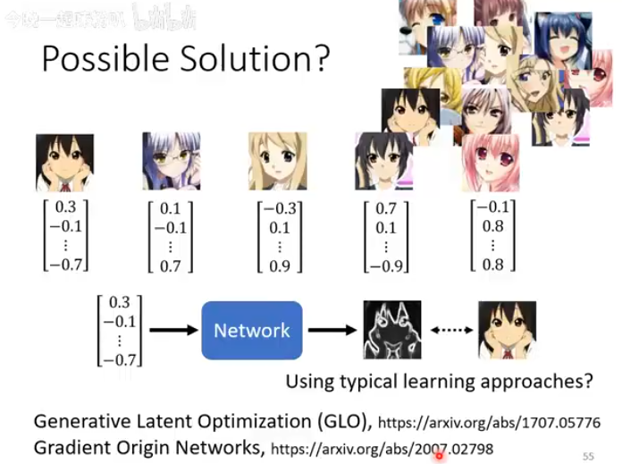

既然「从 z 生成」这件事可以是「找一个 z 让网络输出等于目标图」，那就把它当**优化问题**解：

```
给定目标图 x，反过来找 z 使得 G(z) ≈ x
```

这就是 **GLO (Generative Latent Optimization)** 和 **Gradient Origin Networks**。
不需要 D，不需要对抗，训练稳定得多 —— 代价是生成新样本时要解一个优化问题。

## 5. 评估：质量 vs 多样性

人类打分太贵、太不稳定，所以需要自动指标。但自动指标几乎都只在测**两个不同的东西**。

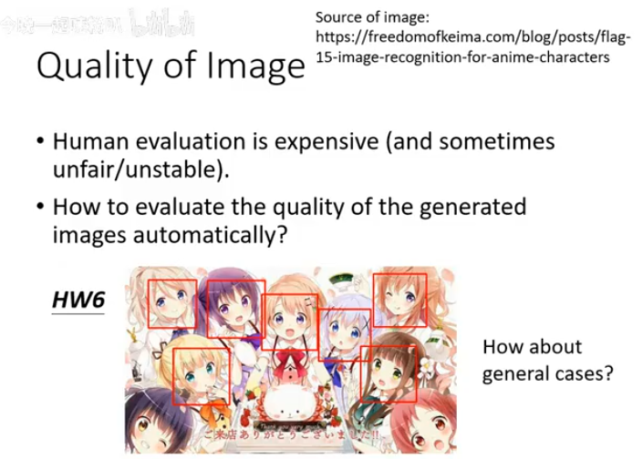

### 质量：单张图像不像

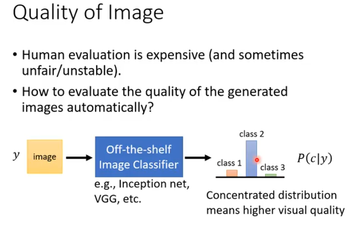

拿 Inception / VGG 之类的分类器，喂一张生成的图，看它的输出分布：

- **集中**（某一类概率很高）→ 图清晰、像某个真实类别
- **分散** → 图糊、四不像

### 多样性：覆盖广不广

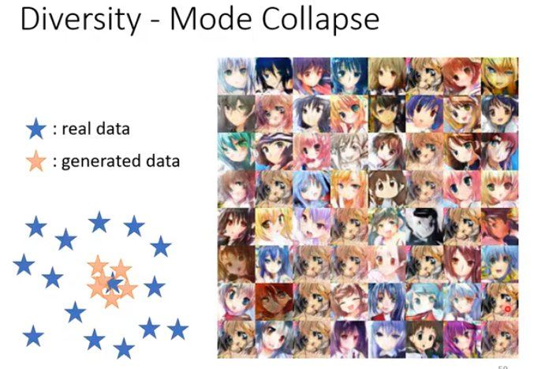

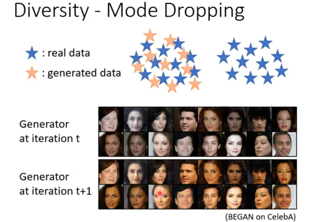

两种崩塌的区别：

| | Mode Collapse | Mode Dropping |
| --- | --- | --- |
| 表现 | 所有输出挤成一团 | 覆盖了一部分，漏掉另一部分 |
| 例 | 只会画一种脸 | 只会画年轻女性，不会画老人 |

多样性怎么量化：把 N 张图的预测分布**平均**起来。

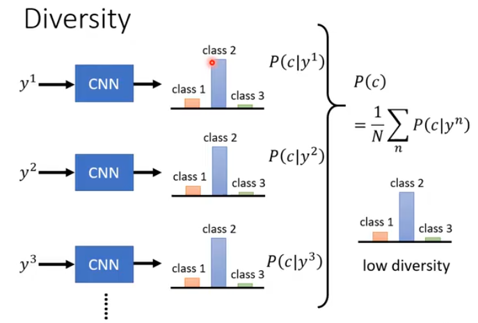

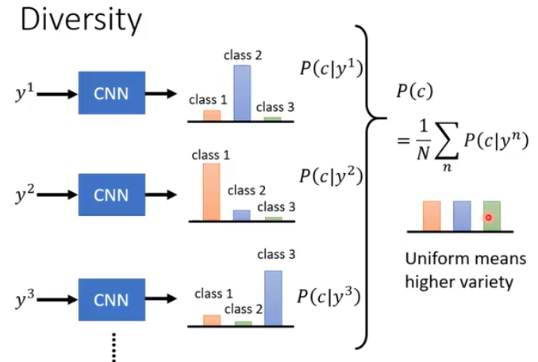

### 实测：覆盖 vs 单张

2D 圆环上，两组生成样本：

| 生成结果 | 覆盖扇区 | 平均半径 | 半径标准差 |
| --- | --- | --- | --- |
| 正常 | **100%** | 1.005 | 0.053 |
| 模式崩塌 | **12%** | 0.999 | 0.020 |

注意崩塌那组的**平均半径和标准差都更"漂亮"**（更集中、更整齐）——
如果只看单张质量，它反而"更好"。

### IS 和 FID

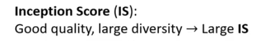

```
IS = exp( E_x[ KL( P(c|y) ‖ P(c) ) ] )
```

前一项要**集中**（质量高），后一项要**均匀**（多样性高）。但它是**单张分开算再平均**的，
所以模式崩塌时只要每张都很"标准"，IS 照样很高 —— 这是 IS 最大的缺陷。

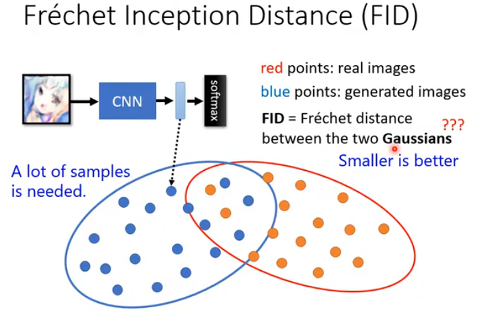

```
FID = ‖μ_real - μ_gen‖² + Tr(Σ_real + Σ_gen - 2(Σ_real Σ_gen)^{1/2})
```

把两组样本的特征都拟合成高斯，比两个高斯有多远。**能捕捉崩塌**，所以更常用。

三个坑：
1. 假设特征服从高斯，实际未必
2. 样本量少时估计有偏（论文建议 ≥ 5 万）
3. **记忆 GAN** 能刷出极低 FID —— 见下

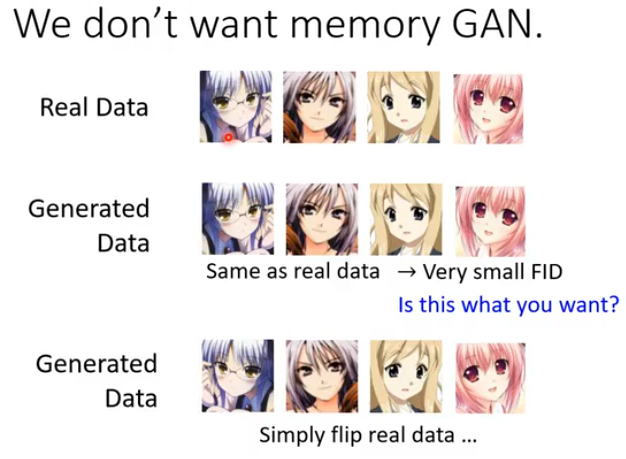

直接把训练集背下来、或者把真图左右翻转一下交上去，FID 会低到离谱。
**指标低 ≠ 生成得好**，这是所有自动评估的共同盲区。

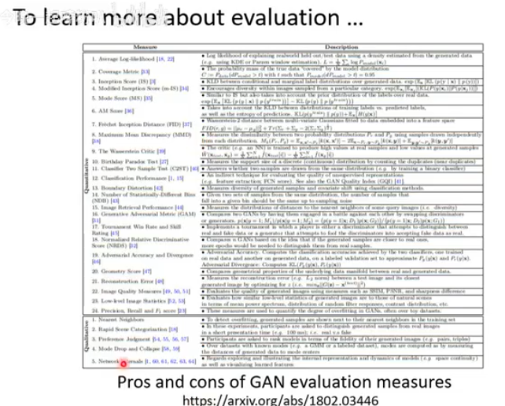

还有一篇大范围对比（*Are GANs Created Equal?*, 1711.10337）测了一堆 loss：

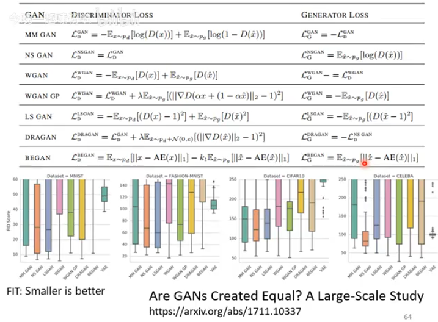

结论很朴素：**没有哪个 loss 全面胜出**，而且同一方法在不同数据集上的排名会变。

## 6. Conditional GAN

前面都是「无条件生成」：给 z，出一张图，内容随机。
条件生成是「给 c（文字、标签、另一张图）+ z，出一张**符合 c** 的图」。

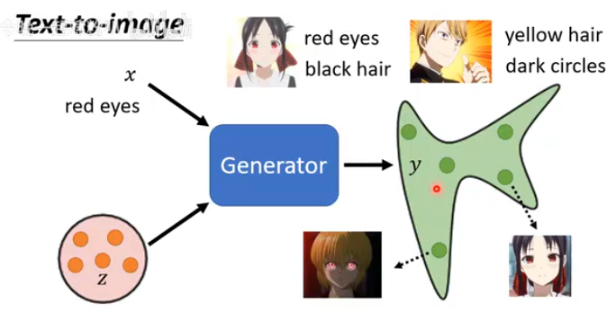

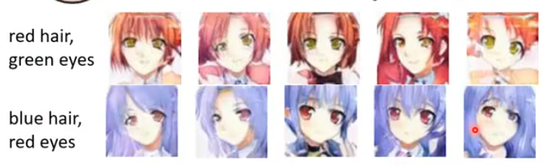

### 关键改动在 D，不在 G

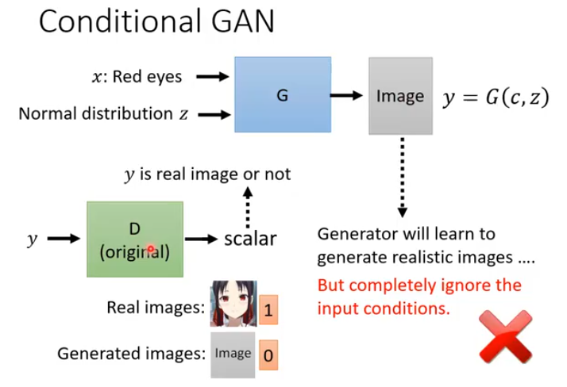

如果 D 仍然只看「这张图真不真」，会发生什么？

G 会学到：**只要图看起来真就行，条件是啥无所谓** —— 因为 D 根本没看 c。
所以「红眼睛」的输入也可能给一张蓝眼睛的图，分数一样高。

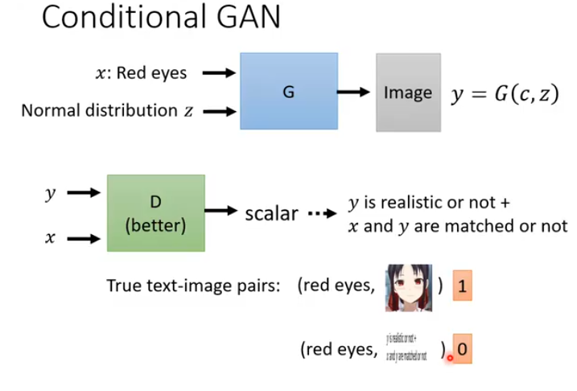

正确的做法：**D 同时接收条件和图，判断这一对配不配**。

| 输入 | 标签 |
| --- | --- |
| 真实图 + 它的真实条件 | 1 |
| 生成图 + 任意条件 | 0 |
| **真实图 + 错误条件** | **0** ← 最关键的一行 |

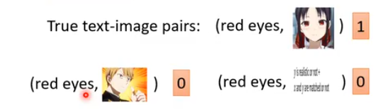

> 你笔记里那句「打分不仅要给生成不出来的打低分，还要给乱配的也打低分」——
> 这就是 Conditional GAN 的全部要点。第三行如果漏了，D 就学不会"配对"这件事。

这跟第 8 章讲的「像 ≠ 对」是同一个问题的两面：**加一条约束，逼 D 检查"对不对"**。

## 7. 应用：pix2pix 和各种翻译

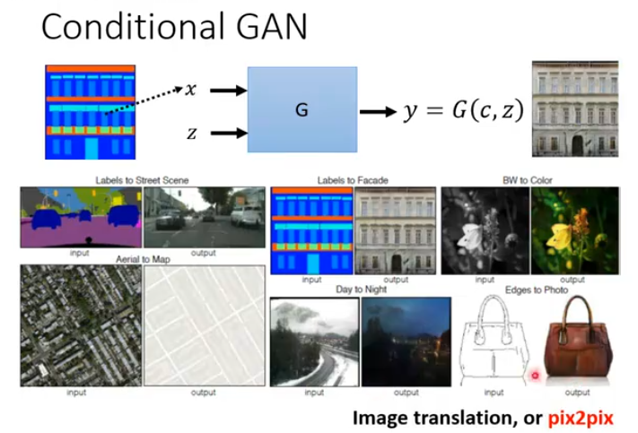

同一套框架，换个条件就是另一个任务：

| 条件 c | 输出 | 任务名 |
| --- | --- | --- |
| 语义分割图 | 街景照片 | labels → street scene |
| 建筑线稿 | 建筑照片 | labels → facade |
| 黑白图 | 彩色图 | colorization |
| 边缘图 | 照片 | edges → photo |
| 白天 | 夜晚 | day → night |

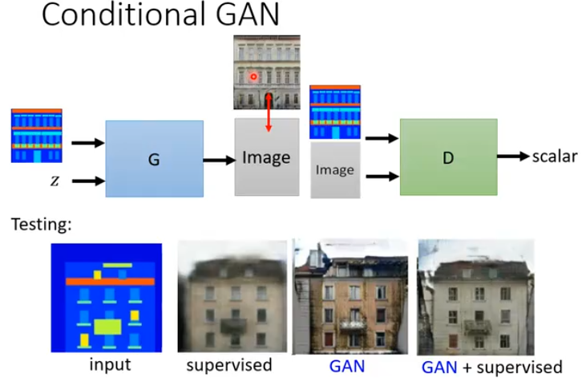

pix2pix 的 D 输入是**两张图**（条件 + 输出），输出一个标量 ——
和上面 Conditional GAN 的结构完全一致。

图上还有一组对比很有意思：

| 做法 | 结果 |
| --- | --- |
| supervised（只用 L1） | 糊 |
| GAN only | 锐利但可能乱加细节 |
| **GAN + supervised** | 锐利且忠于输入 |

这就是 pix2pix 的核心配方：**L1 loss 保证"大结构对"，对抗 loss 保证"细节真"**。
只用 GAN 会幻觉出输入里没有的东西，只用 L1 会糊。

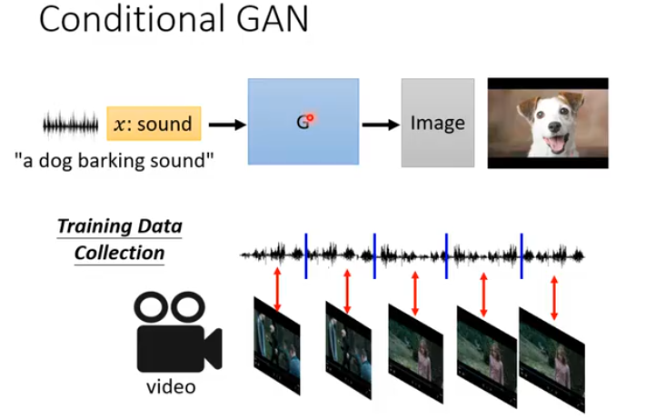

声音转图像：条件是一段音频的特征，训练数据从视频里自动配对（画面 + 对应音轨）。

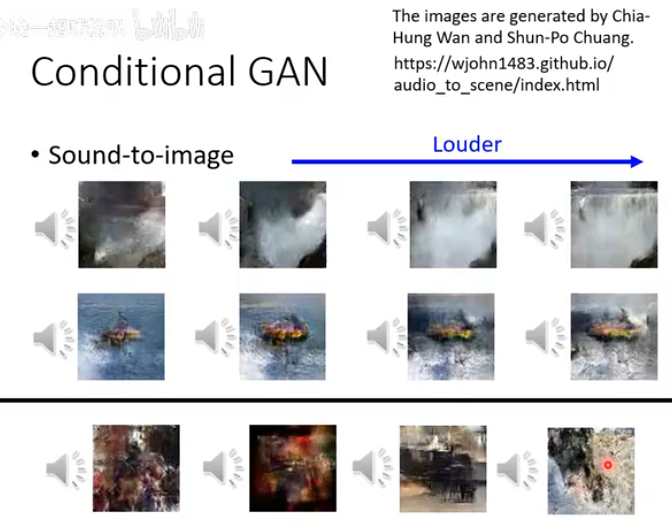

这张图挺好的：模型学到了「响度」这个连续条件，而不是死记某个音频片段。

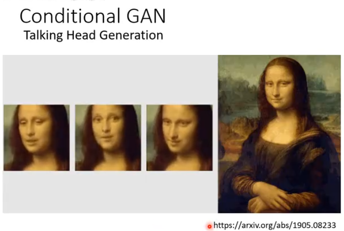

语音驱动的说话头。条件是一段音频，要求生成的口型和音频对齐 ——
又是一个「条件 + 生成」的问题。

## 8. Q&A

**Q：为什么不能把 argmax 换成 softmax 期望就完事了？**
A：期望 embedding 不是任何一个真实 token，拿它去骗 D 是"作弊"：
你算的是一个平均值的分数，不是实际输出的分数。Gumbel-softmax 的做法是
前向仍取 hard、反向借用 soft 的梯度，是这个矛盾的折中。

**Q：RL 里 reward 用 D 的输出，会不会被 D 骗？**
A：会，而且很严重。D 只是当前的一个近似，G 会去钻它的空子（第 8 章实测过：
对着冻结的 D 训 300 步，分数能从 0.003 冲到 1.000）。所以还是要交替训练。

**Q：IS 和 FID 哪个更可信？**
A：FID 更常用，因为它看整体分布。但两个都别当真理 —— 记忆 GAN 能刷爆 FID，
而且 FID 依赖特定的 Inception 特征，换数据集/分辨率就可能失效。

**Q：Conditional GAN 里条件怎么喂进去？**
A：常见三种：① 直接拼到输入（最简单）；② 用 FiLM / AdaIN 做仿射变换（调制中间层）；
③ attention（文本条件常用，类似 cross-attention）。D 那边一定要**同时**看到条件和图。

## 9. 对应代码

```bash
python main.py gan
```

第 8、9 节是这一篇的代码部分：

- 第 8 节：argmax 断梯度（概率 0.316→0.903 而 score 变化 0）→ soft 路径对比 → REINFORCE 跑通
- 第 9 节：覆盖率的量化（正常 100% vs 崩塌 12%）
