# 11 · 无配对数据：Cycle GAN 与 Text Style Transfer

> 一句话：对抗损失只约束「输出像不像 Y」，管不了「这个 x 变成了哪个 y」。
> cycle consistency 用「转过去能转回来」补上这个约束。

## 1. 什么叫「无配对」

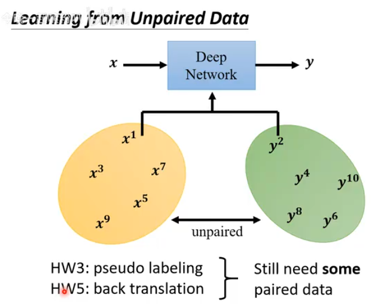

| | 数据 | 例子 |
| --- | --- | --- |
| 有监督 | `(x, y)` 成对 | 同一张图的线稿 + 照片 |
| 无配对（unpaired） | 两堆各自独立 | 一堆真人照片、一堆动漫脸 |

课件的两条旧路子（HW3 伪标签、HW5 回译）都**仍然需要一些配对数据**，
所以不算真正的 unpaired。

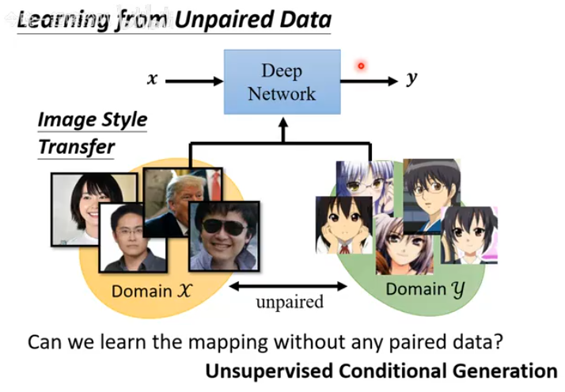

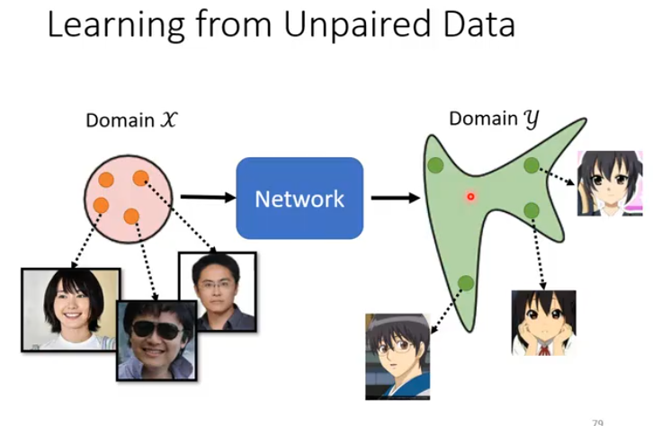

## 2. 只有对抗损失会怎样

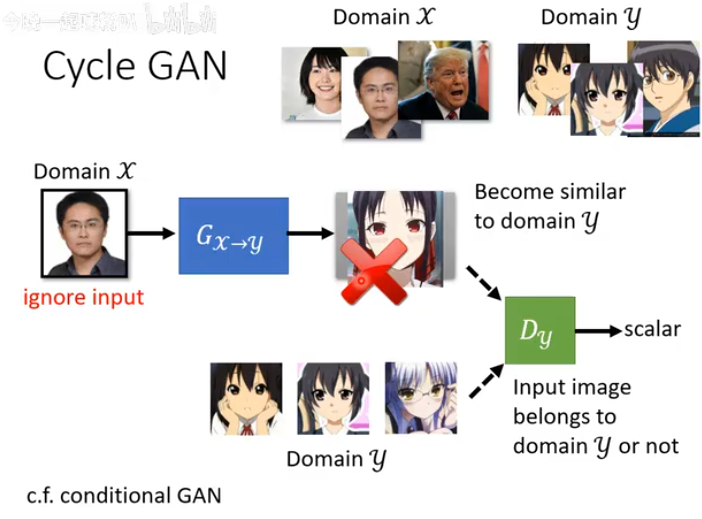

问题很清楚：`D_Y` 只回答一个问题 —— **「这张图属于 Y 域吗」**。
它不知道这张图和输入有没有关系。

所以 `G_XY` 只要把任何输入都映射成「一张像 Y 的图」，就能拿满分。
课件在那个输出上打了个红色叉号，标注 **"ignore input"**。

用分布的 language 说：

```
对抗损失只约束   P(y)          ← 输出的边际分布
管不了           P(y | x)      ← 给定输入的条件下，应该输出什么
```

### 实测：这个 toy 上居然没塌

2D 玩具任务：X 是 x 轴上的一段线，Y 是 y 轴上的一段线，两类点各采 256 个，**完全不配对**。

| 训练方式 | 往返误差 | 输入-输出相关性 | 输出分散度 |
| --- | --- | --- | --- |
| 只有对抗损失 | 0.057 | **-0.997** | 0.567 |
| 对抗 + cycle (λ=10) | **0.033** | -0.999 | 0.579 |

**结果和预期相反**：不加 cycle 时 G 自己就学到了单调映射，没有出现「ignore input」的崩塌。
加 cycle 只是把往返误差压了约 42%。

为什么？因为 X 和 Y 都是一维线段，「均匀铺开 + 保持顺序」恰好是**最省力**的解。
梯度下降的归纳偏置在这类干净空间里自然选到了对的。

> 这是一个诚实的负面结果，值得单独记一句：
> **这个 2D toy 验证不了课件里那个惨状。** 它只能验证 cycle 项确实在压可逆性。

真实任务为什么必须加？因为真实数据有**内容歧义**：
一匹马可以对应无数张斑马，`P(y|x)` 里有很多合法答案，
而对抗损失对它一点约束都没有。toy 里没有这种歧义。

## 3. Cycle Consistency

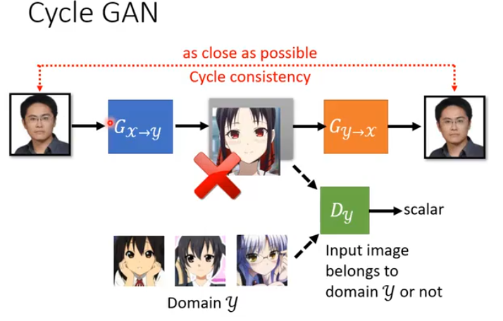

```
L = L_GAN(G_XY, D_Y) + λ · ‖G_YX(G_XY(x)) - x‖
```

第二项就是 **cycle consistency**：`x → G_XY(x) → G_YX(·) ≈ x`。

它不告诉你"正确的输出是哪个"，只要求**输出必须保留重建所需的信息**。

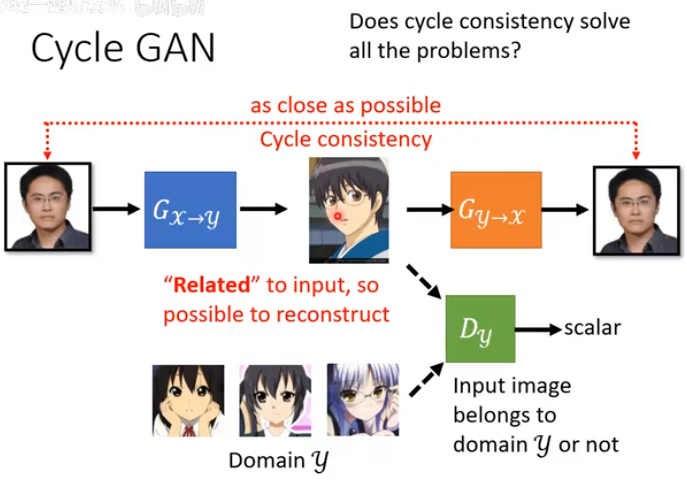

课件那句话说得很好：输出必须 **"related to input, so possible to reconstruct"**。
如果 G 把输入的信息全丢了，`G_YX` 再厉害也变不回来。

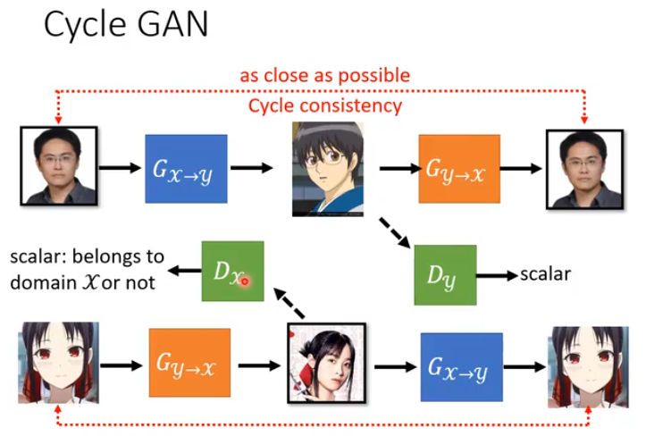

双向都要：`X→Y→X` 和 `Y→X→Y`，各配一个判别器 `D_X` / `D_Y`。

| λ 太小 | λ 太大 |
| --- | --- |
| 退化成普通 GAN，映射可能乱掉 | 只顾重建、输出不像 Y（退化成自编码器） |

原论文取 `λ = 10`。

**一个必须澄清的边界**：cycle 只保证**可逆**，不保证**正确**。
多个可逆映射都能通过这个损失 —— 它不会告诉你哪一个是语义上对的那一个。

## 4. 同期的一批工作

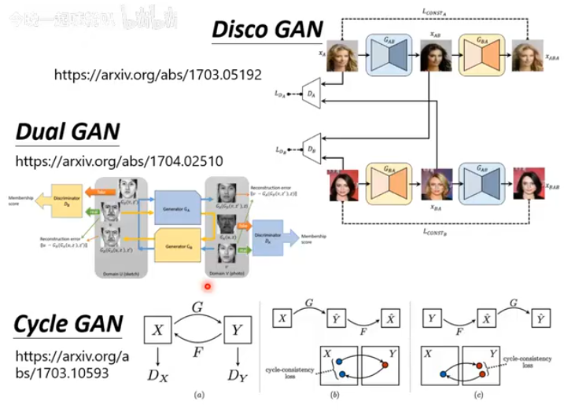

三个几乎同时（2017）的工作，思路都是「双向 + 一致性」：

| 方法 | 差别 |
| --- | --- |
| Cycle GAN (1703.10593) | 两个生成器 + 两个判别器 + cycle loss，最简洁 |
| Disco GAN (1703.05192) | 同样的双向结构，强调「发现共享特征」 |
| Dual GAN (1704.02510) | 权重共享（两个 G 共用一部分参数） |

到 2017 年底大家发现这三家本质上是一回事，后来引用基本都记在 Cycle GAN 名下。

## 5. StarGAN：多个域用一个生成器

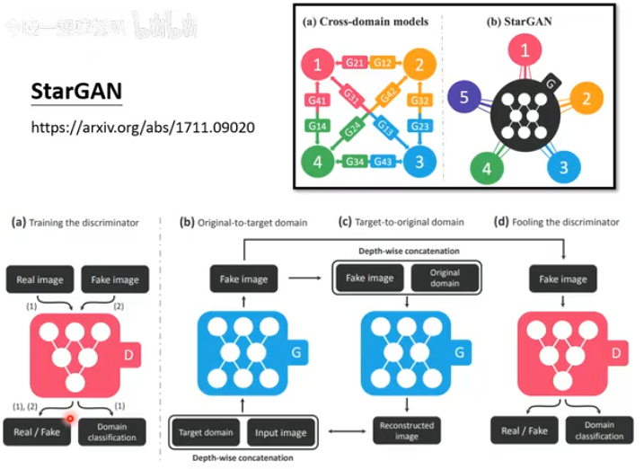

Cycle GAN 的局限：`k` 个域两两配对需要 `k(k-1)` 个生成器。StarGAN 改成：

- **一个 G**：输入是 `(图, 目标域标签)`
- **一个 D**：输出是 `(真/假, 域分类)`

这样 4 个域只需要 1 个生成器。代价是 D 要多做一个分类任务 ——
但那个分类信号反过来也帮了 G（"像不像目标域"变得可监督）。

## 6. Text Style Transfer

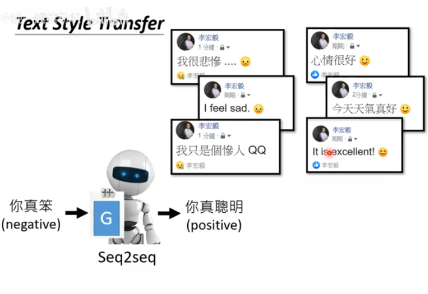

任务：`你真笨` → `你真聪明`，`我很难过` → `我很开心`。**没有配对数据**
（没人给你准备好每一句的"正面版本"）。

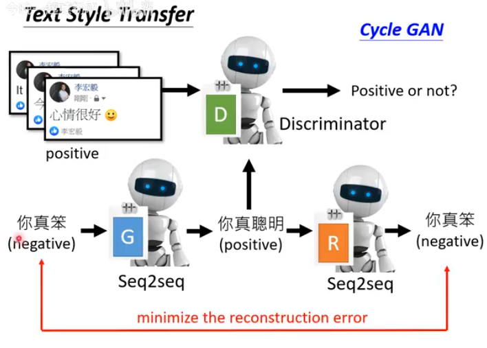

结构完全照搬 Cycle GAN，只是把 `G_YX` 换成了 `R`（重建网络）：

| 组件 | 作用 |
| --- | --- |
| G (seq2seq) | 负面 → 正面 |
| D | 判断"是不是正面句子" |
| R (seq2seq) | 正面 → 负面（重建） |

问题又回到了第 8 章那个：**文本是离散的，生成那一步不可导**。
所以这里的 G 和 R 通常先用 MLE 预训练（有平行语料的任务上），再用 RL 微调。

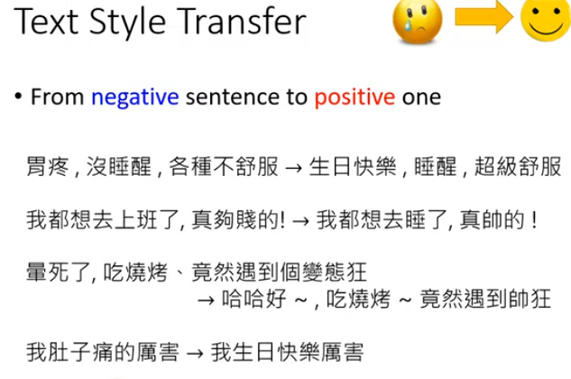

看第二行：`量死了，吃烧烤，竟然遇到个变态狂` → `哈哈好~，吃烧烤~ 竟然遇到帅哥`
干净。但第三行 `我肚子痛的厉害` → `我生日快乐的厉害` ——
**语义崩了，但"正面"这个风格确实学到了**。

这就是纯风格迁移的通病：**只换了风格，不管内容通不通**。
后来的工作（如对照学习、内容保留约束）就是在补这块。

## 7. 同一套思路的其他应用

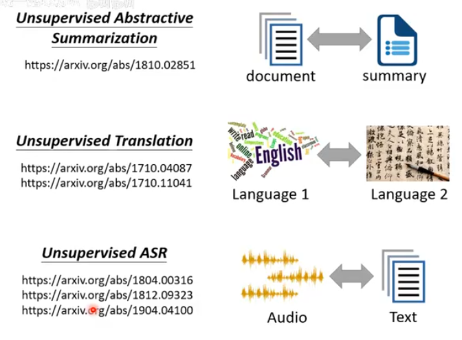

| 任务 | 两个域 | 论文 |
| --- | --- | --- |
| 无监督摘要 | 文档 ↔ 摘要 | 1810.02851 |
| 无监督翻译 | 语言 A ↔ 语言 B | 1710.04087 / 1710.11041 |
| 无监督 ASR | 音频 ↔ 文本 | 1804.00316 等 |

它们都是「两堆无配对数据 + 双向一致性」，只是换了域的定义。

## 8. 全课总结

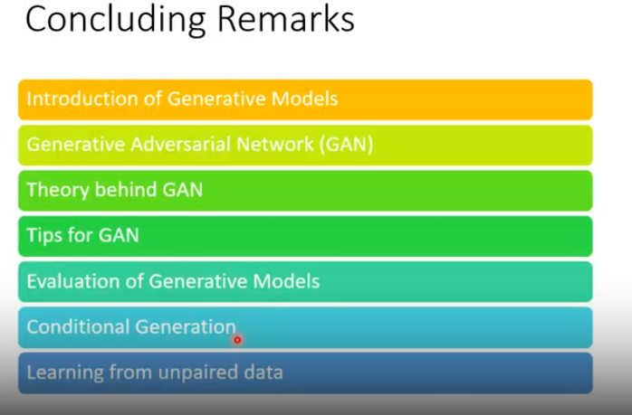

| 模块 | 一句话 | 我们验证了什么 |
| --- | --- | --- |
| 生成模型导论 | 需要的是分布，不是均值 | MSE 在双峰数据上输出 **0** |
| GAN | G 和 D 交替对抗 | 冻结 D 时 D 参数变化 **0.00e+00** |
| GAN 理论 | `min_G max_D V`，V 的最大值是 JS | `max_D V` 与 `2·JS-2log2` 精确相等 |
| GAN 技巧 | 平衡、历史回放、非饱和损失 | 对固定 D 练 300 步，分数 0.003→**1.000**（钻空子） |
| 评估 | 质量看单张、多样性看覆盖 | 崩塌时覆盖率 100%→**12%**，但单张更"整齐" |
| 条件生成 | 条件要喂给 D，D 要判断"配不配" | — |
| 无配对 | cycle 保证可逆，不保证正确 | 往返误差 0.057→**0.033** |

## 9. Q&A

**Q：cycle consistency 为什么能"传递"语义？**
A：它传递的不是语义，是**信息**。要求 `G_YX(G_XY(x)) ≈ x`，等价于要求
`G_XY` 在数据支撑集上**单射**（不同 x 不能映射到同一个 y）。
单射就排除了"把所有输入变成一个模样"这种退化。

**Q：那多个单射映射都能通过，Cycle GAN 怎么选？**
A：不选。它只给一个可行解，具体落到哪一个由初始化、网络结构、λ 共同决定。
这是 Cycle GAN 被诟病的核心 —— 同样的代码在不同 seed 上可能给出不同风格的结果。

**Q：为什么文本任务比图像难？**
A：两个原因：① 离散输出，argmax 断梯度（第 8 章实测过）；② 文本的"像不像"很难定义，
`D` 判别一句话是不是正面情绪，比判别一张图是不是动漫脸要模糊得多。

**Q：现在还有人用 Cycle GAN 吗？**
A：图像翻译里还有（尤其医学图像、卫星图这种配对成本极高的场景）。
但主流已经被 diffusion 取代 —— 它不需要对抗平衡，训练稳得多。

## 10. 对应代码

```bash
python main.py gan
```

第 10 节是本篇的代码：两个 1D 线段之间的无配对映射，对比「只有对抗」和「对抗 + cycle」，
输出往返误差、输入-输出相关性、输出分散度。
